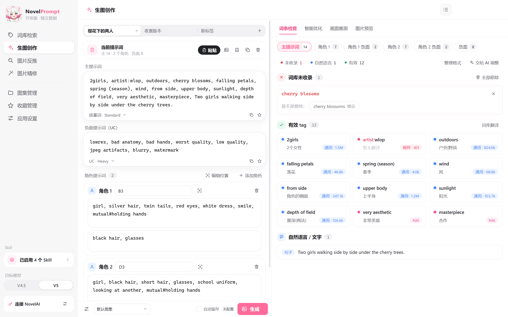
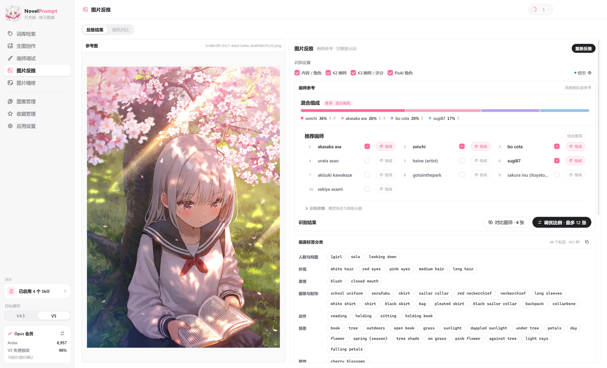
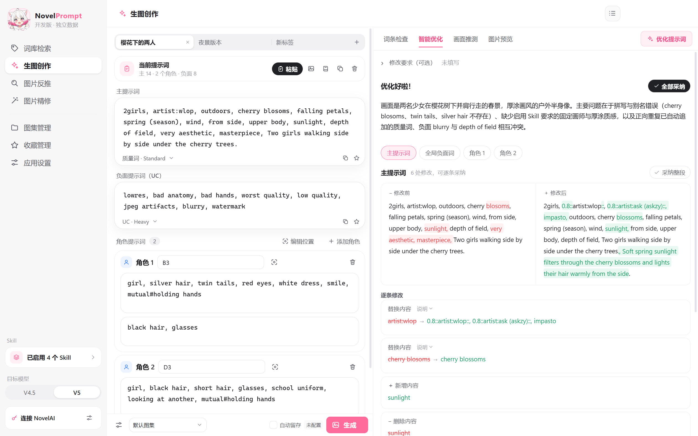
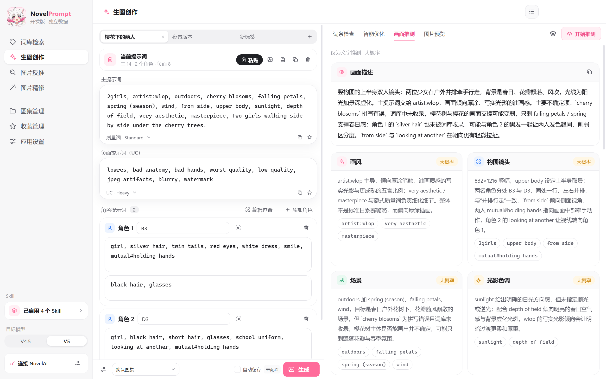
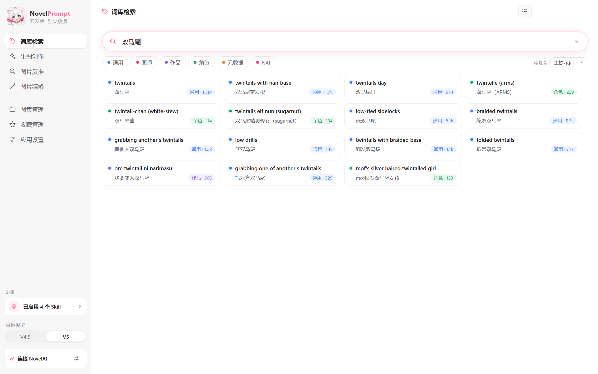
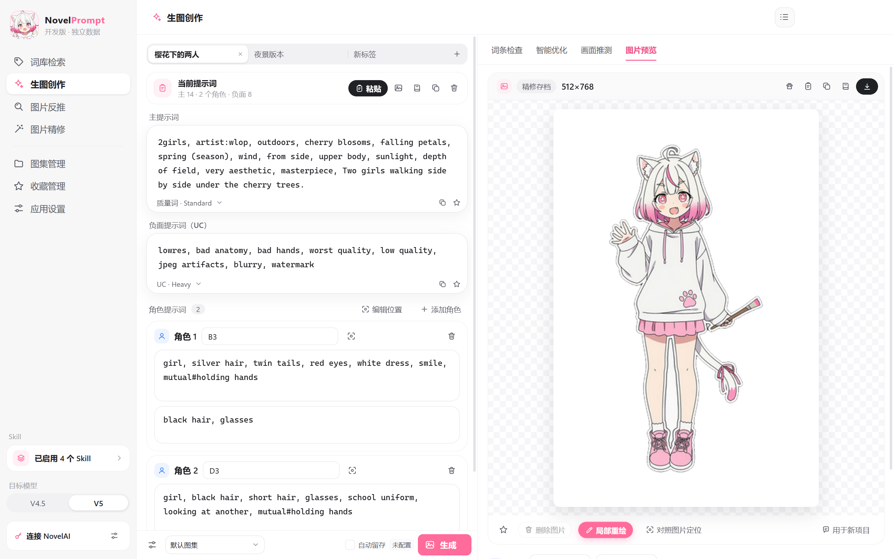
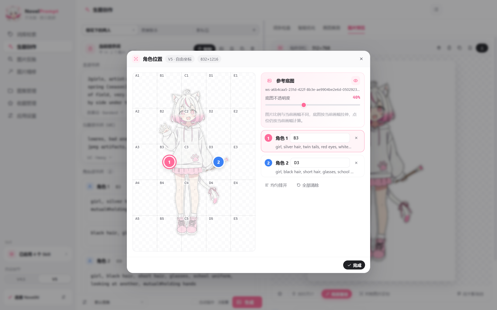
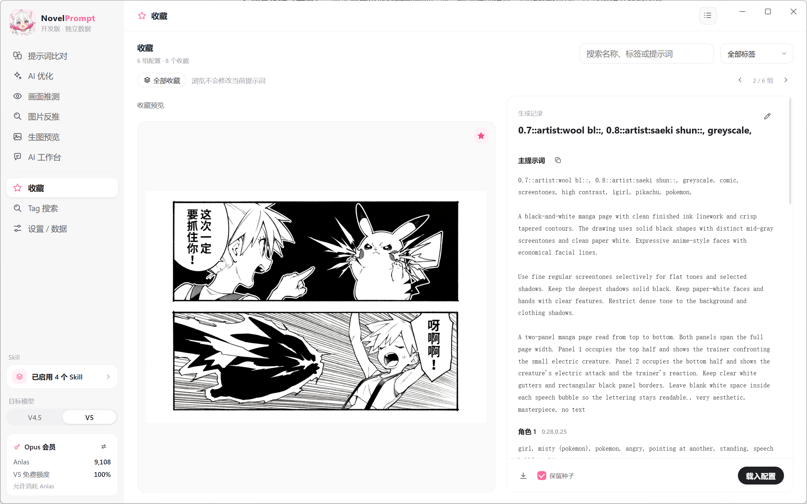
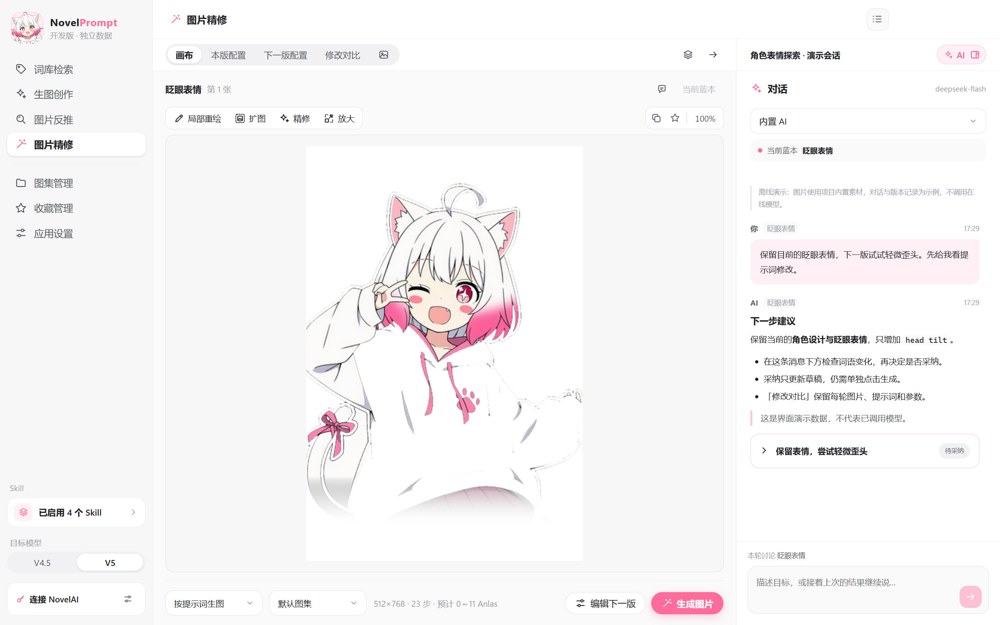
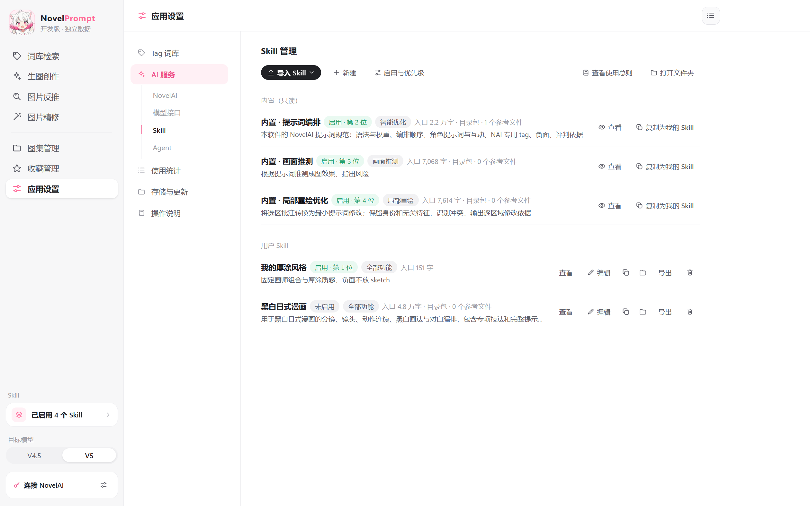

  
  <h1>NovelPrompt</h1>
  
与 AI 一起，把想法变成画面，把画面逐步调整到满意。

  
NovelAI 创作桌面工具 · Windows 10 / 11 x64 · v1.1.0

  

    <a href="https://github.com/Morgiana-V3/novel-prompt/releases/latest">下载最新版</a> ·
    <a href="CHANGELOG.md">更新记录</a> ·
    <a href="docs/usage-guide.md">使用与开发参考</a>
  

NovelPrompt 把提示词、NovelAI 生图和 AI 协作放在同一个工作区。从一句描述或一张已有图片出发，整理提示词、生成画面，再通过对话不断调整。

**1.1.0 更新重点**：完整图片反推、独立画师调试、法典 / NAX 双来源图鉴，以及完整角色与位置配置的生图衔接。详见 [本版更新记录](CHANGELOG.md)。

开发维护：[架构说明](docs/architecture.md) · [代码写作规范](docs/coding-standards.md)。

- **AI 协作创作**：围绕当前图片讨论，让 AI 提出修改方案，保留每次尝试并比较结果。
- **提示词辅助**：在「生图创作」一页内完成词条检查、智能优化、画面推测和图片预览，结合本地词库核对 tag，输入时自动补全。
- **多标签创作**：像浏览器一样同时开多个标签，每个标签的提示词、参数、历史和结果各自独立，方便并行尝试几套方案。
- **图片反推（实验）**：结合本地标签与 AI 识图得到全局、负面、角色和位置提示词，独立提供画师参考，完整结果可带入生图创作。
- **画师调试与图鉴**：固定底稿比较画师串；图鉴默认法典，可切换 NAX，支持收藏、加入画师串和跳转原站。
- **图片收藏**：收藏图片与生成配置，支持分组、搜索、标签、备注和配置复用。
- **NovelAI 生图与重绘**：支持 V4.5 / V5、多人提示词、角色位置、局部重绘和区域批注。
- **本地 Agent 接入**：通过 MCP 使用词库和生图能力，也能接管工作台、写回方案，在软件中逐步展示操作。
- **自定义创作规则**：用 Skill 告诉 AI 你的编排习惯和创作偏好，在不同环节沿用。

## 从一张图，或一个想法开始

支持从 NovelAI 原始 PNG 恢复提示词与生成参数，让已有作品成为下一次尝试的起点。

还没有图片也没关系：用中文描述想画的内容，让 AI 整理成提示词；也可以直接粘贴已有提示词。提示词在词条检查、智能优化、画面推测和图片预览之间共用，不必反复搬运；想同时试几套方案时，开多个标签各自独立。从图集、收藏或原图载入配置时，当前标签有内容就自动新开一个标签承接，不会覆盖正在编辑的提示词。

## 多标签创作

像浏览器一样同时打开多个创作标签，每个标签的提示词、参数、历史和结果各自独立，方便并行试几套方案。

  

## 图片反推

**图片反推（实验）**先用本地 WD / PixAI / Kaloscope 模型提供内容、角色身份与画师候选，再把参考图和候选交给设置中的识图模型，整理全局、负面建议、角色及位置提示词。本地标签识别在电脑上运行；完整提示词反推会发送图片到配置的 AI 接口并消耗其额度。本地模型未就绪时仍可运行完整反推，但没有相应本地画师参考。

反推结果只读，分类标签帮助理解角色、服装和环境；需要修改时将完整配置带入「生图创作」。这条反推流程不加载内置或用户创作 Skill，负面词和位置是复现建议，不是恢复原始生成参数。

  

支持画师组合与权重调整、固定条件试图、原图与结果对比，以及风格相似度评分。画师推荐用于辅助选择画风，不代表原作者判定。

## 画师调试与图鉴

「画师调试」可从创作标签、图库或收藏选择底稿，在相同内容、参数与种子下比较不同画师串。支持画师补全、权重调整、原图与生成结果对照，并将选中的结果带回生图创作。V4.5 与 V5 分别保留调试草稿，目标模型沿用侧栏的全局切换。

从「画师图鉴」浏览例图、搜索画师、收藏或加入当前画师串。默认来源为法典，也可切换 NAX；两者跟随当前模型显示对应图集，共用画师收藏。例图需要联网加载，来源、收录范围和测试条件可能不同，不将其视为严格的同条件比较。

「原站」打开当前来源与模型的图集，「TAGs」提供额外的外部浏览入口。NAX 例图注明作者、CC BY 4.0、索引日期和原站公布的测试条件。

## 让提示词更接近你想要的画面

**智能优化**既能整理已有提示词，也能把中文想法转换为完整方案。画风、场景、人物特征、多人位置和台词分别编排，修改内容与理由一起展示，由你决定是否采用。

  

**画面推测**帮助你在生成前检查表达是否清楚：这组提示词可能呈现怎样的构图、人物和光影，哪些内容可能冲突或不确定。它提供的是分析参考，实际效果仍以出图为准。

查看画面推测

  

这些能力背后有本地收录的 **33 万个 Danbooru tag**、别名、包含关系与中文翻译。词条检查可以发现拼写、别名和重复问题，Tag 搜索支持中文、英文和拼音；两者均可离线使用。AI 也能查询词库及在线统计，为建议提供依据。

查看词条检查与 Tag 搜索

  

  

## 用 NovelAI 生成，也能只调整局部

支持 **NovelAI V4.5 / V5** 的提示词生图，包含多角色提示词、角色负面、画幅、种子与采样参数。生成结果保存在本机图库，可按图集分组管理，支持留存、删除和图片收藏，方便回看、复用或带入 AI 工作台。生成图片保留提示词与参数，支持后续导入。

  

**角色位置可视化**让多人构图更直观。可以对照已有图片调整每个角色的位置：V4.5 使用网格，V5 使用自由坐标，参考底图支持透明度调节。

查看角色位置与参考底图

  

**局部重绘**用于保留已有画面、调整指定区域。区域批注把“哪里要改”和“想怎么改”交给 AI，修改方案可以先核对再采纳；多处修改支持逐区域生成，选区外的像素由本地合成保留。

## 图片收藏

收藏图片预览、画师试图和工作台中的图片，同时保存提示词与生成配置。支持同配置图片分组、搜索、标签、备注和原图导出，来源图片清理后仍可查看收藏。

  

图片与生成配置并排展示，方便查阅和复用。浏览收藏不影响当前提示词，复用配置时可选择保留原始种子。

## 在工作台里，和 AI 持续打磨一张图

「图片精修」（AI 工作台）把**当前画面、对话、提示词和历史版本**放在一起。告诉 AI 想保留什么、哪里还不满意，它会结合图片与已有讨论提出下一轮方案，协作过程随会话保存。

  

**建议与执行分开。** AI 给出方案后，可以先看完整的提示词差异，再决定采用、修改或放弃。既可以重新生成整张图，也可以围绕选区进行局部调整。

**历史版本与修改对比。** 保留每次生成的图片、提示词和参数，支持版本对比、历史引用与继续创作。

**一次讨论多处修改。** 支持多个区域的批注、联合讨论与局部重绘，内置 AI 和外部 Agent 均可参与。

「编辑配置」用于修改下一次生成的提示词和参数；「生成记录」只读展示实际生成时使用的配置。查看历史、修改下一稿不会改写已生成图片的记录。

工作台支持内置 AI 和外部 Agent 协作，结合当前图片、区域批注、Skill 与历史记录提出修改建议。

## 让 AI 按你的规则创作

Skill 是可以导入和编辑的 Markdown 创作规则。软件内置提示词编排、画面推测和局部重绘规范，也允许叠加自己的偏好，或用自己的规则替换内置规则。

支持单个 Markdown 文件与 Skill 文件夹的导入、编辑和预览，也可管理规则附带的参考资料与图片。

启用的 Skill 会按适用范围用于文字创作、画面推测和工作台协作。图片反推使用独立的识图流程，不读取这些创作规则。

查看 Skill 管理

  

截图中的自定义 Skill 为使用示例，可按需导入自己的规则。

## 也能交给本地 Agent

通过 **MCP**，Codex、Claude Code、Cursor 等 Agent 可以使用词库、检查提示词、读取图片配置，以及调用 AI 分析、NovelAI 生图和局部重绘。也能接管工作台讨论、提交修改建议和生成新版本。

支持后台处理与前台协作，可读取当前界面和截图，并在软件中展示操作过程。普通创作和工作台协作可读取启用的 Skill；完整图片反推独立于创作 Skill，外部 Agent 可提交反推草稿供审阅、采纳和带入生图。付费能力可单独控制。

MCP 使用本地 stdio，支持 2025-11-25 及更早的初始化握手协议；客户端需要支持对应协议或兼容回退。画师图鉴目前没有来源切换、收藏或添加画师的专用 MCP 操作。

任务中心统一显示生成、识别和 Agent 操作的状态与记录，支持查看进度和取消任务。

[MCP 接入说明](docs/agent-install.md)

## 下载与开始体验

到 [Releases](https://github.com/Morgiana-V3/novel-prompt/releases/latest) 下载 **Windows x64 安装版**；也提供便携版，MCP 接入需使用安装版。

| 文件 | 用途 |
| --- | --- |
| `NovelPrompt-Setup-1.1.0.exe` | 安装版，支持应用内更新及 MCP 接入 |
| `NovelPrompt-Portable-1.1.0.exe` | 便携版，无需安装，后续手动更新 |
| `latest.yml` / `*.blockmap` | 自动更新的版本清单与差量下载信息，无需手动打开 |
| `Source code` | 项目源码，不是可直接运行的安装包 |

安装版支持应用内更新，便携版手动下载更新。用户数据独立保存。

本地词条检查与搜索开箱即用。AI 功能需要配置自己的模型接口：内置 DeepSeek、GPT（OpenAI）、通义千问、智谱 GLM、Kimi 预设，也支持其他兼容接口。完整图片反推、图片精修的 AI 讨论和局部重绘方案需要模型能识图，设置页会提示当前模型能否识图，不能时可另配一个识图模型并一键测试。本地标签与画师识别模型在反推页按需下载；从 1.0.0 升级无需为完整反推更换已有本地模型。生图与重绘需要 NovelAI 账户及 API Token，可能扣费时会先提示确认，实际额度以服务端为准。

从旧版升级前保存当前编辑并结束任务。安装版可使用应用内更新，也可运行新版安装包；升级后完整重启应用，使用 MCP 的客户端重新连接。

[完整更新记录](CHANGELOG.md) · [使用与开发参考](docs/usage-guide.md) · [MCP 接入说明](docs/agent-install.md)

---

基于 Electron、Vue 与 TypeScript 构建。标签数据来自 [Danbooru](https://danbooru.donmai.us/)，社区中文翻译来自 [a1111-sd-webui-tagcomplete-CN](https://github.com/byzod/a1111-sd-webui-tagcomplete-CN)。生图服务由用户自己的 NovelAI 账户提供。

应用代码采用 [MIT License](LICENSE)。外部图鉴内容遵循各自的许可：[法典许可范围](https://github.com/AgIzT/NovelAI-Tag/blob/main/LICENSE) 不将配图和编纂数据纳入 MIT；[NAX](https://nax.moe/) 按原站 CC BY 4.0 标注作者和来源。本项目的代码许可不替代第三方内容许可。
