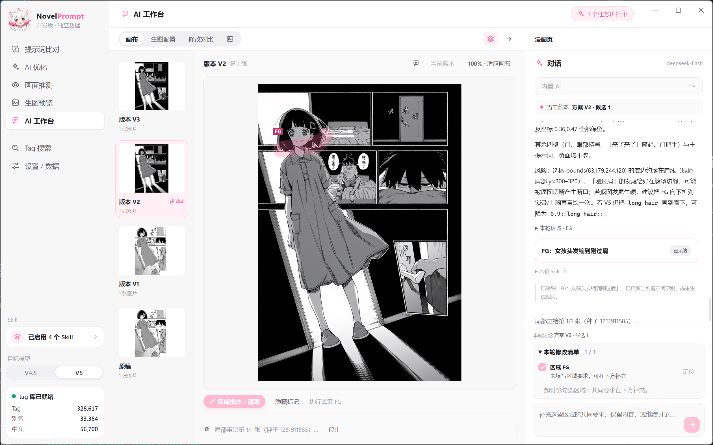

  
  <h1>NovelPrompt</h1>
  
与 AI 一起，把想法变成画面，把画面逐步调整到满意。

  
NovelAI 创作桌面工具 · Windows 10 / 11

  

    <a href="https://github.com/Morgiana-V3/novel-prompt/releases/latest">下载最新版</a> ·
    <a href="CHANGELOG.md">更新记录</a> ·
    <a href="docs/usage-guide.md">使用与开发参考</a>
  

NovelPrompt 把提示词、NovelAI 生图和 AI 协作放在同一个工作区。从一句描述或一张已有图片出发，整理提示词、生成画面，再通过对话不断调整。

开发维护：[架构说明](docs/architecture.md) · [代码写作规范](docs/coding-standards.md)。

- **AI 协作创作**：围绕当前图片讨论，让 AI 提出修改方案，保留每次尝试并比较结果。
- **提示词辅助**：中文描述转提示词、AI 优化、画面推测，结合本地词库核对 tag。
- **图片反推（实验）**：按需启用本地内容与画师识别，编辑候选组合、固定参数试图、比较风格并收藏配置。
- **NovelAI 生图与重绘**：支持 V4.5 / V5、多人提示词、角色位置、局部重绘和区域批注。
- **本地 Agent 接入**：通过 MCP 使用词库和生图能力，也能接管工作台、写回方案，在软件中逐步展示操作。
- **自定义创作规则**：用 Skill 告诉 AI 你的编排习惯和创作偏好，在不同环节沿用。

## 从一张图，或一个想法开始

**把 NovelAI 原始 PNG 拖进窗口，就能接着创作。** 拖入图片、选择文件和从图库加载都会读取提示词；元数据完整时，一并恢复模型、种子、步数、采样器等生成参数，并支持撤销导入。只有部分元数据时，缺失的生成参数保持当前值。

还没有图片也没关系：用中文描述想画的内容，让 AI 整理成提示词；也可以直接粘贴已有提示词。提示词在比对、优化、推测和生图之间共用，不必反复搬运。

**没有元数据的图片可以使用「图片反推」。** 内容 / 角色（WD）、K2 画师、K3 画师 / 评分、PixAI 角色可分别勾选，软件只下载、检查和运行选中的模型；默认 WD + K2 + K3 约 1.61 GB；可选 PixAI INT8 另需约 524 MB，不强制下载。也可从模型管理中的固定版本来源下载后导入。软件自带运行引擎，无需安装 Python，使用 CPU。本地识别和风格评分不上传参考图、不消耗 Anlas；下载支持取消、校验修复与按所选模型删除。已完成的模型文件会保留。模型选择和阈值会记住。

**角色识别**：WD 与 PixAI 分别使用独立角色阈值（默认 0.85 / 0.27），角色候选不会自动写入提示词。两者同时勾选时，WD 提供基础内容，PixAI 提供角色身份。进入「角色识别」可点选候选、编辑标签，加入主提示词或最多 6 个角色栏。多人图可点击「框选人物」，拖选后识别选区；选区只运行所选的内容 / 角色模型，不覆盖全图基础词与画师结果。角色分配随画师组合一起用于本页试图，采用配置时再带入普通生图页的角色栏。局部外观标签仍需人工清理，框选不等于自动识别人物边界。

反推页分为「识别与提示词」和「试图与对比」两个步骤。选择、拖入或在页面非文本输入区域粘贴图片后只显示参考图，点击「开始识别」才运行本地模型。缺模型时列出名称、用途和待下载大小；下载、导入模型完成或修改模型选择后，同样需要手动点击识别。识别完成后停留在结果编辑区，默认选取前三个推荐组合，没有画师候选时提供无画师对照。全图、选区识别及风格评分接入右上角任务中心，统一显示进度、完成与失败记录，可取消任务并返回反推页。侧栏「图片反推」位于「生图预览」上方。

「识别与提示词」采用左侧参考图填满可用高度、右侧编辑区统一滚动的布局；提示词、画师与角色内容随长度展开，不再各自嵌套滚动。顶部步骤切换不悬浮覆盖内容，小窗口自动改为上下排列。仅左侧参考图框接收拖入的图片，主题色拖拽反馈也限定在图框内；拖到右侧或页面空白处不会导入。松开后载入参考图，仍需手动开始识别。可修改基础标签阈值、角色、画师候选与组合，编辑和复制提示词，也可添加当前画师串或无画师对照。当前画师串和各个试图方案都支持逐项输入权重、每次加减 0.05、重置为 1 或移除画师，输入精度为 0.001；权重与原始画师串双向同步，调整共享权重组中的单个画师不会改变其他画师。确认后点击「去试图」，在同一反推页的第二步并排查看原图与当前方案，下方通过缩略图切换本轮或上一轮结果；默认准备三个组合，待生成方案只占缩略图位置。反推试图不再单独配置生图参数，模型跟随侧边栏的全局选择（切换成功会显示 toast）；可返回第一步继续调整，已有试图结果保留。点击「生成 3 张预览」才开始逐张试图，不改写其他页面的提示词与参数。每轮最多 6 组、每组一张，提交前冻结各方案完整请求，同轮固定内容、参数和种子，只改变画师组合。停止后保留已完成图片，服务返回停止原因时也停止整个队列。沿用现有免费限制 / Anlas 设置，需要联网，可能消耗 Anlas。

原图和当前方案都可放大查看；当前方案的信息栏集中提供提示词与参数、换种子再试、留存及收藏配置，收藏会先留存图片。试图区填满可用高度，图片与缩略图区固定，仅右侧信息栏纵向滚动，展开详情不改变双图尺寸。完整提示词以可选中复制的普通卡片文本展示。缩略图固定宽度，只显示图片、方案编号和状态，完整画师串在当前方案信息栏查看。支持点击和左右方向键切换。图片放大后可点击空白遮罩或按 Esc 返回，拖动图片不会触发关闭；预览期间禁用窗口的关闭、最小化和最大化按钮，退出预览或重新加载界面后恢复。启用 K3 后可比较返图风格，评分失败保留图片且不重新生图。同一参考图保留上一轮结果供回看；更换参考图或重新识别会清空本页试图记录，生成的图片仍按图库规则保存。仅点击结果的「采用配置」才把该图完整配置带到普通生图页，并可撤销导入。普通生图页不再承担画师试图队列。

Tag 库状态与数量统计保留在设置页，不再占用侧边栏。会员状态、Anlas 余额及当前模型适用的免费额度统一显示在侧边栏底部，各生图入口共用；生图、重绘或工作台任务结束后自动刷新，也可手动刷新。额度恢复时间放在悬浮提示中，点击额度使用方式可进入设置。Anlas 余额变化时，账户卡片上方短暂显示本次消耗或增加金额；首次读取、切换账户和余额不变时不弹。设置里的 NovelAI 卡片单独保存 Token，支持清空保存或「清除 Token」，保存失败与连接测试失败分别提示。

反推试图默认使用 832×1216、28 步、Euler Ancestral / native、Rescale 0；V5 Guidance 为 4，V4.5 为 5。开启质量词，使用 Light UC，无额外自定义负面词；有 K3 特征时自动评分。同轮只改变画师串，模型和参数在提交前冻结；切换侧边栏模型只影响下一轮，换种子重试仍复用原图配置。此配置是快速测试的产品默认值，并非统一的画师评测标准：参考[画师标签对比实验](https://www.reddit.com/r/NovelAi/comments/1vuuvvs/i_tested_1900_artist_tags_in_nai_diffusion_v5/)固定参数、种子的做法；采用 Light 而非 Heavy，减少对网点和半色调等风格特征的压制，预设差异见[官方 UC 文档](https://docs.novelai.net/en/image/undesiredcontent/)。

画师候选不代表原作者或原始画师串；建议组合的权重是待试用值，排名分数与 K3 风格相似度都不是权重或还原百分比。当前没有自动迭代搜索，多人物属性、复杂动作和位置关系仍需手动核对，尚未接入 Qwen 增强。PNG / JPEG / WebP 输入上限为 25 MB、2400 万像素。

查看创作会话的不同起点

  

## 让提示词更接近你想要的画面

**AI 优化**既能整理已有提示词，也能把中文想法转换为完整方案。画风、场景、人物特征、多人位置和台词分别编排，修改内容与理由一起展示，由你决定是否采用。

  

**画面推测**帮助你在生成前检查表达是否清楚：这组提示词可能呈现怎样的构图、人物和光影，哪些内容可能冲突，哪里与期望有差距。它提供的是分析参考，实际效果仍以出图为准。

查看画面推测

  

这些能力背后有本地收录的 **33 万个 Danbooru tag**、别名、包含关系与中文翻译。提示词比对可以发现拼写、别名和重复问题，Tag 搜索支持中文、英文和拼音；两者均可离线使用。AI 也能查询词库及在线统计，为建议提供依据。

查看提示词比对与 Tag 搜索

  

  

## 用 NovelAI 生成，也能只调整局部

支持 **NovelAI V4.5 / V5** 的提示词生图，包含多角色提示词、角色负面、画幅、种子与采样参数。生成结果保存在本机图库，支持留存、删除和收藏生成配置，方便回看、复用或带入 AI 工作台。

新生成的图片将完整生成记录保存在 PNG 内，不再附带同名 JSON。原有 NovelAI 元数据和图片像素保持不变；单独导出 PNG 后仍可加载生成参数。旧 JSON 暂不迁移或读取。

  

**角色位置可视化**让多人构图更直观。可以对照已有图片调整每个角色的位置：V4.5 使用网格，V5 使用自由坐标，参考底图支持透明度调节。

查看角色位置与参考底图

  

**局部重绘**用于保留已有画面、调整指定区域。区域批注把“哪里要改”和“想怎么改”交给 AI，修改方案可以先核对再采纳；多处修改支持逐区域生成，选区外的像素由本地合成保留。

  

## 在工作台里，和 AI 持续打磨一张图

AI 工作台把**当前画面、对话、提示词和历史版本**放在一起。告诉 AI 想保留什么、哪里还不满意，它会结合图片与已有讨论提出下一轮方案，协作过程随会话保存。

  

**建议与执行分开。** AI 给出方案后，可以先看完整的提示词差异，再决定采用、修改或放弃。既可以重新生成整张图，也可以围绕选区进行局部调整。

**每次尝试都有迹可循。** 来源图片与结果并排展示，提示词、角色和生图参数按组突出变化，未修改内容默认隐藏，长文本可展开核对。可以引用历史画面继续讨论，也可以从更满意的旧版本继续探索。

查看历史版本与修改对比

  

**一次讨论多处修改。** 在画布标记要改的位置，勾选“本轮修改清单”中的区域并补充要求，内置 AI 或外部 Agent 会联合讨论并给出完整方案。采纳后先查看合并范围，再用统一提示词和强度重绘；未勾选区域不纳入遮罩。

查看区域批注与工作台重绘

  

**选择谁来处理讨论。** 工作台支持内置 AI 和外部 Agent 两种处理者。外部接管时，Agent 读取图片、选区、启用的 Skill 与历史，自己分析并写回对话和建议，不转调 DeepSeek。新方案保留完整修改前后记录，可回看每条建议。

## 让 AI 按你的规则创作

Skill 是可以导入和编辑的 Markdown 创作规则。软件内置提示词编排、画面推测和局部重绘规范，也允许叠加自己的偏好，或用自己的规则替换内置规则。

支持导入单个 Markdown 文件或包含 `SKILL.md` 的文件夹。查看时显示排版后的正文，编辑时可切换源码、预览和分栏；参考资料与图片可从文件列表或正文链接打开。

启用的 Skill 会用于对应的 AI 功能和工作台协作，让不同项目拥有各自的表达方式。

查看 Skill 管理

  

截图中的自定义 Skill 为使用示例，可按需导入自己的规则。

## 也能交给本地 Agent

通过 **MCP**，Codex、Claude Code、Cursor 等 Agent 可以使用 NovelPrompt 的本地词库、提示词检查、图片提示词读取、Skill 管理，以及 AI 分析、NovelAI 生图和局部重绘能力。Agent 还可以读取当前界面状态、切换页面、同步提示词，并在 AI 工作台提交修改建议、采纳和生成新版本。窗口与多个 Agent 共用任务及生图锁，操作会反映到界面中；状态订阅是否触发模型行动取决于客户端支持。

**两种操作方式。** 后台模式保留原有工具，可无窗口处理数据；前台模式使用 `ui_*` 工具，在实际工作台中逐步填写、提交讨论、展示建议、绘制区域批注并生成。前台有操作状态与停止入口，直接复用软件交互逻辑，无需电脑操作插件。详见[前台与后台接入说明](docs/agent-install.md#前台模式在实际界面中执行工作流)。

Agent 也可以用 `ui_capture_app` 获取当前应用窗口的真实截图，查看弹窗、画布与未提交输入，并在操作后核对实际效果。你在软件里操作后发消息，Agent 可重新读取最新状态与截图；这属于按需观察，不是持续录像或完整操作历史。

软件内启用的 Skill 也能提供给 Agent，让桌面创作与外部协作沿用同一套规则。接入时可选择工具范围或按需加载，减少无关说明；需要账户额度的工具受独立权限控制。

**Agent 有自己的操作指南。** 连接时提供入口，`agent_guide` 按需说明能力地图、前后台选择、操作流程和异常恢复；具体提示词规则仍使用软件内启用的 Skill。

外部接管目前由 Agent 主动读取处理：在软件里发送需求不会自动唤醒外部模型，断线也不会自动回退内置 AI。后台表示不展示操作步骤，仍共享应用数据，部分结果会同步到界面；前台自动化覆盖工作台与矩形区域重绘，并非任意控件自动化。

顶部任务中心统一显示运行进度与取消入口。任务开始时左上角标识保持稳定，后台任务和 Agent 操作可以在同一处查看。

[让 Agent 帮你安装并接入 →](docs/agent-install.md)

## 下载与开始体验

到 [Releases](https://github.com/Morgiana-V3/novel-prompt/releases/latest) 下载 **Windows x64 安装版**；也提供便携版，MCP 接入需使用安装版。

从 v0.6.0 起，安装版支持后台下载新版，完成后点击「重启并更新」，在任务结束并保存编辑后升级。v0.5.0 及更早版本需先手动安装一次新版；便携版继续手动下载。程序与内置 Skill 随版本更新，用户数据保存在独立目录。[发布更新说明](docs/auto-update.md)

本地比对与搜索开箱即用。AI 功能需要配置自己的 DeepSeek 或兼容接口，含图协作需要模型支持图像输入；生图与重绘需要 NovelAI 账户及 API Token，默认开启免费额度检查，实际额度以服务端为准。

[完整更新记录](CHANGELOG.md) · [使用与开发参考](docs/usage-guide.md) · [MCP 接入说明](docs/agent-install.md)

---

基于 Electron、Vue 与 TypeScript 构建。标签数据来自 [Danbooru](https://danbooru.donmai.us/)，社区中文翻译来自 [a1111-sd-webui-tagcomplete-CN](https://github.com/byzod/a1111-sd-webui-tagcomplete-CN)。生图服务由用户自己的 NovelAI 账户提供。

[MIT License](LICENSE)
