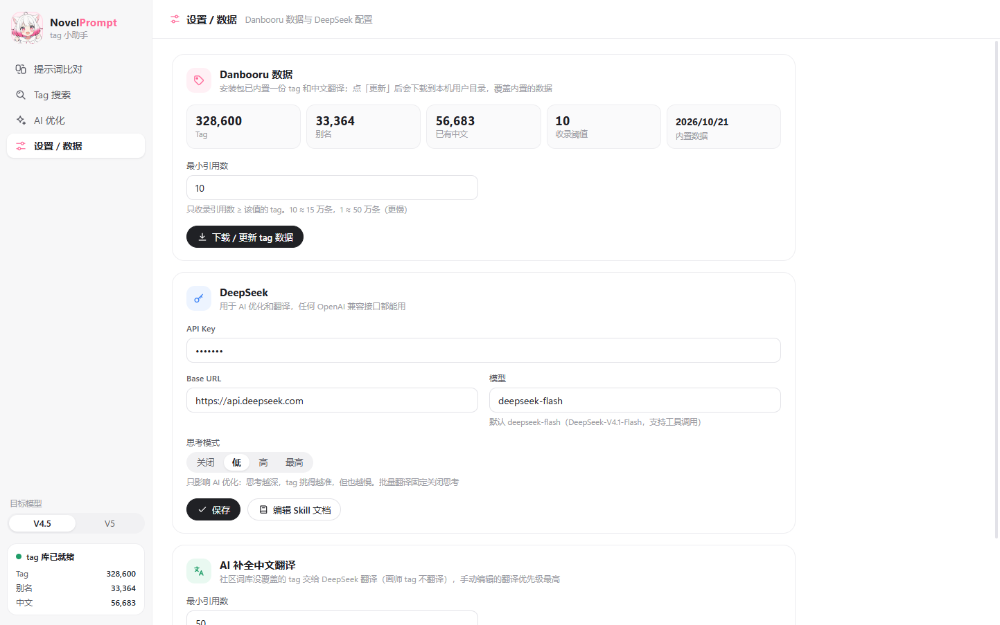

<div align="center">
  
  <h1>NovelPrompt</h1>
  <p>写 NovelAI 提示词时，帮你把每一个 tag 都核对清楚。</p>
  <p>
    
    
    
  </p>
</div>

---

NovelPrompt 是一个 NovelAI 出图用的桌面小工具。它把 Danbooru 的 **30 万个 tag** 和 **5 万多条中文翻译** 打包在本地，所以你粘贴一段提示词进去，它能立刻告诉你：哪些 tag 是真实存在的、哪些拼错了、哪些是别名、哪些根本不是 tag。

内置的数据是离线的，断网也能用。只有 AI 优化需要联网（接 DeepSeek）。

## 目录

- [功能](#功能)
- [界面预览](#界面预览)
- [快速开始](#快速开始)
- [使用指南](#使用指南)
- [支持的语法](#支持的语法)
- [数据说明](#数据说明)
- [常见问题](#常见问题)
- [开发者](#开发者)
- [致谢](#致谢)

## 功能

### 提示词比对

左边输入，右边实时拆成四组：

- **不存在的 tag** — 红色标出，用编辑距离给出候选，点一下就替换
- **别名 / 非标准写法** — 例如 `twin tails` 会提示改成 `twintails`，可以一键全部修正
- **有效 tag** — 显示中英双语、分类、引用数、权重，双击中文可以改成你习惯的译名
- **自然语言 / 文字** — V5 允许的英文句子、`Text:` 块会被单独列出，不会误报

点右边任意一条结果，左边会自动选中对应的原文，方便你定位。

### Tag 搜索

- 中文、英文、**拼音全拼和首字母** 都能搜（输入 `smw` 就能找到「双马尾」）
- 按分类筛选：通用 / 画师 / 作品 / 角色 / 元数据 / NAI 专用
- 结果按匹配度 × 引用数排序，引用数高的 tag 效果通常更稳定
- 单击加入提示词末尾，右键复制，双击中文可编辑翻译

### AI 优化

两种模式：

- **优化现有提示词** — 修正拼写和别名、删掉冲突和冗余、按规范顺序重排、补上缺失的关键 tag
- **描述转提示词** — 用中文描述画面，AI 拆成概念后到本地库里挑真实存在的 tag

AI 不能凭空编造 tag：它会调用本地 tag 库检索和校验，输出前再由程序在本地复查一遍，发现不存在的 tag 会打回去让它重改，最多两轮。最后给出正向提示词、角色提示词、负面提示词和逐条修改说明。

### V4.5 / V5 双版本

侧栏可以切换目标模型，会同时影响两件事：

- 比对时的警告（例如在 V4.5 下用了 V5 专用 tag、或用了 V4.5 不认的引号文字）
- AI 的编排规则（多角色位置写法、自然语言混写比例、质量词等）

## 界面预览

| 提示词比对 | Tag 搜索 |
|---|---|
|  |  |

| AI 优化 | 设置 / 数据 |
|---|---|
|  |  |

## 快速开始

### 用安装包（推荐）

1. 到 [Releases](https://github.com/your-name/novel-prompt/releases) 下载 `NovelPrompt-Setup-x.x.x.exe`
2. 安装后直接打开，**内置数据已经就绪，不需要下载任何东西**
3. 想用 AI 优化的话，在「设置 / 数据」里填入 DeepSeek API Key

> 环境要求：Windows 10 / 11（x64）。首次启动约需 1 秒加载索引。

### 从源码运行

```bash
git clone https://github.com/your-name/novel-prompt.git
cd novel-prompt
npm install
npm run dev
```

国内网络如果卡在 Electron 下载，先设置镜像：

```powershell
$env:ELECTRON_MIRROR="https://npmmirror.com/mirrors/electron/"
npm install
```

需要 Node 20 或更新版本（推荐 22）。

### 打包

```bash
npm run dist     # 输出 NSIS 安装包和便携版到 release/
```

## 使用指南

### 第一次打开

打开就是「提示词比对」页，左下角会显示 `tag 库已就绪` 和当前收录数量。不需要任何配置就能开始用。

要用 AI 优化，去「设置 / 数据」页：

1. 填 **API Key**（在 [DeepSeek 开放平台](https://platform.deepseek.com/) 申请）
2. 模型默认 `deepseek-flash`，也可以填其他 OpenAI 兼容接口
3. 思考强度默认「低」，想要更准可以调高，但会更慢

### 比对一段提示词

把提示词粘进左边，右边马上出结果。基本流程：

1. 先看 **不存在的 tag**，点候选替换，或点「全部移除」
2. 再看 **别名**，点「全部修正」统一成标准写法
3. 剩下的 **有效 tag** 检查一下权重和警告
4. 左下角有一排按钮：整理格式（统一逗号空格）、复制、清空、AI 优化

内置的 NAI 专用 tag（`masterpiece`、`high complexity`、`no text` 等）会被识别为有效，不会误报为不存在。

### 查一个 tag

切到「Tag 搜索」，输入中文或英文。比如想找「双马尾」：

- 输入 `双马尾`、`twin tails`、`smw` 都能命中
- 点一下结果就加到提示词里，画师 tag 会自动带上 `artist:` 前缀

### 让 AI 改提示词

切到「AI 优化」：

- 选「优化现有提示词」，左边会自动带入比对页的提示词，可以在「额外要求」里补充「换成夜景」这类想法
- 或者选「描述转提示词」，直接用中文写画面
- 点「开始」，左边的步骤列表会显示 AI 正在查哪些 tag
- 结果出来后可以「应用到比对页」继续微调，或直接复制

### 数据更新

Danbooru 每天都在变。想用最新数据：

1. 「设置 / 数据」→ 调「最小引用数」（默认 10，约 33 万条；填 1 会到 50 万条，下载更慢）
2. 点「下载 / 更新 tag 数据」，会拉取 Danbooru 的 tag、别名表和社区中文翻译
3. 社区词库没覆盖的翻译，可以点「开始 AI 翻译」用 DeepSeek 补

更新后的数据存在本机用户目录，不会影响安装包里的内置数据。

## 支持的语法

| 写法 | 说明 |
|---|---|
| `tag1, tag2` | 逗号或换行分隔 |
| `{tag}` / `{{tag}}` | 加权 ×1.05（可叠加） |
| `[tag]` | 减权 ÷1.05 |
| `1.3::tag, tag2::` | 数值权重，可包住多个 tag |
| `-1::tag::` | 负权重，主动从画面里去掉某概念 |
| `artist:名字` | 画师 tag，会校验是否真的是画师分类 |
| `year 2024` | 年份 tag |
| `|` | 分段，常用于多角色提示词 |
| `source#hug` / `target#hug` / `mutual#...` | 角色间的互动动作 |
| `Text: ...` | 画面文字块（V4.5 需手写，且放末尾） |
| `"文字"` | V5 引号文字，会自动识别 |
| `long hair` / `long_hair` | 下划线和空格等价 |
| `hatsune miku \(append\)` | 括号是名字的一部分，会正确还原 |

## 数据说明

| 层 | 位置 | 内容 | 读写 |
|---|---|---|---|
| **内置数据** | 安装包 `resources/default-data/`（gzip，约 5.7MB） | tag、别名、社区翻译、AI 翻译、拼音索引 | 只读 |
| **用户数据** | `%APPDATA%\novel-prompt\data\` | 你自己下载的 tag、新增的 AI 翻译、手动改的翻译、设置（含 API Key） | 可写 |

- tag / 别名 / 社区翻译：两层里**抓取时间更新的**那份生效
- 翻译：按条目合并，优先级 **手动编辑 > AI 翻译 > 社区翻译**，用户层优先
- 升级或重装不会覆盖你的用户数据

**隐私**：API Key 只存在本机 `settings.json` 里，只会发送给 DeepSeek 官方接口。打包脚本有白名单，`settings.json` 永远不会被导出进安装包。

## 常见问题

**断网能用吗？**
能。比对和搜索完全离线，数据都在本地。

**AI 功能要花钱吗？**
要，用的是你自己的 DeepSeek API Key，按 token 计费。只做比对和搜索不花钱。

**内置数据会过期吗？**
会。Danbooru 一直在新增 tag，内置数据是发版时的快照。想要最新的就点「下载 / 更新」，之后每次启动都用你更新过的数据。

**AI 挑出来的 tag 还是不对怎么办？**
AI 的编排规则写在 `skills/nai-prompt.md`（设置页可以「编辑 Skill 文档」直接打开）。这份文档就是 AI 的系统提示词，改完立即生效，可以按自己的习惯调整顺序、权重、负面词模板。

**能用在 SD / WebUI 上吗？**
可以。tag 数据来自 Danbooru，和 SD 通用的那套一致，只是权重语法是 NovelAI 的。

**打包报 EPERM？**
如果输出目录在桌面这类受保护位置，electron-builder 解压 Electron 后改名会被系统拒绝。换个输出目录即可：

```bash
npm run dist -- "--config.directories.output=D:\build\novel-prompt"
```

## 开发者

### 技术栈

Electron 44 · Vue 3 · TypeScript · Vite（electron-vite）· 内存索引搜索 · DeepSeek Function Calling

没有用数据库：33 万条 tag 读进内存后用线性扫描 + 打分排序，几十毫秒出结果，省掉原生模块编译的麻烦。

### 结构

```
src/main/tagdb     数据抓取（fetcher）、两层数据读取（layers）、内存索引与搜索（store）、NAI 专用 tag
src/main/prompt    提示词解析器与比对
src/main/ai        DeepSeek 客户端、优化器（工具调用 + 校验循环）、批量翻译
src/renderer       Vue3 界面（components/icons.ts 自绘图标，components/Mascot.vue 猫娘）
skills/            AI Skill 文档
default-data/      随安装包分发的内置数据
scripts/           数据处理、吉祥物生成脚本
```

### 常用脚本

```bash
npm run dev          # 开发模式（热更新）
npm run build        # 只构建
npm run typecheck    # 类型检查
npm run dist         # 打包安装包 + 便携版
npm run data:export  # 把本机数据导出为内置数据 default-data/
```

### 更新内置数据（发版前）

```bash
npm run data:export   # 从 %APPDATA%\novel-prompt\data 导出到 default-data/
npm run dist
```

导出脚本只认白名单文件（tags / aliases / zh-community / zh-ai / zh-user / pinyin-cache），`settings.json` 不会被导出。

### 吉祥物

立绘是拿 NovelAI 生成的，同一个 seed 保证七个表情是同一个角色。需要重新生成时：

```bash
$env:NAI_KEY="pst-..."       # 你自己的 NovelAI Token，不要提交
$env:NAI_SEED="777"
python scripts/gen-mascot.py         # 生成到 assets-src/mascot/
python scripts/process-mascot.py     # 抠底、裁边、输出到 src/renderer/src/assets/mascot/
```

依赖 Python 3 和 Pillow。`process-mascot.py` 会顺带生成 `build/icon.ico`（应用图标）。

## 致谢

- tag 数据来自 [Danbooru](https://danbooru.donmai.us/)，版权归 Danbooru 及各位贡献者
- 社区中文翻译来自 [byzod/a1111-sd-webui-tagcomplete-CN](https://github.com/byzod/a1111-sd-webui-tagcomplete-CN)
- 界面风格参考 OpenAI Codex 的浅色布局

本项目仅用于提示词编写辅助，不提供任何图像生成能力。

## 许可证

[MIT](LICENSE)
