# 使用与开发参考

[返回产品介绍](../README.md)

这里保留详细操作、参数说明、MCP 工具列表和开发命令，需要时查阅。

## 功能

### 当前提示词

主提示词、角色提示词（含位置和角色负面）、负面提示词，以及画幅 / Add Quality Tags / UC 预设，在整个软件里只有**一份**，自动保存，重启也在。比对、AI 优化、画面推测、生图四个页面编辑和使用的都是它，不需要在页面之间来回搬运。

每个页面顶部都有「当前提示词」工具条：

- **导入** — 点「粘贴」从剪贴板导入；在主提示词里直接粘贴整套分节文本也会自动拆分；把 NovelAI 原图拖进窗口任意位置，读取图里保存的提示词。支持 `[Prompt]` / `[Character 1 @ B3]` / `[Character 1 Undesired Content]` / `[Undesired Content]` 分节文本、`## 负面`、`UC:` 这类写法，以及 NAI 元数据 JSON
- **历史版本** — 导入、采用 AI 结果、清空、恢复之前都会自动存一份（最多 30 条），可以撤销上一次，或恢复到任意版本
- **复制全部** — 导出为分节文本，和导入格式互通
- **编辑位置** — 角色提示词上方的「编辑位置」打开画布，按当前画幅显示每个角色的点位，直接拖动即可（也可以点空白处把选中的角色移过去、方向键微调），位置实时写回角色提示词。V4.5 吸附到 A1~E5 网格并高亮所在格，V5 是自由的 `x,y` 坐标；也可以「均匀排开」「转成网格」或「全部清除」交给模型排布
- **参考底图** — 在「生图预览」选中图片后，位置画布会透出该图片，方便对照人物调整点位；也可点击图片下方的「对照图片定位」。支持显示 / 隐藏底图和调节不透明度，切到其他提示词页面仍可使用当前图片。图片比例与当前生成画幅不同时会提示拉伸，坐标始终对应当前生成画幅

侧栏按工作流排列：比对 → AI 优化 → 画面推测 → 生图预览，下面是 Tag 搜索和设置两个工具页。侧栏底部是 Skill 选择和目标模型切换。

<p align="center">
  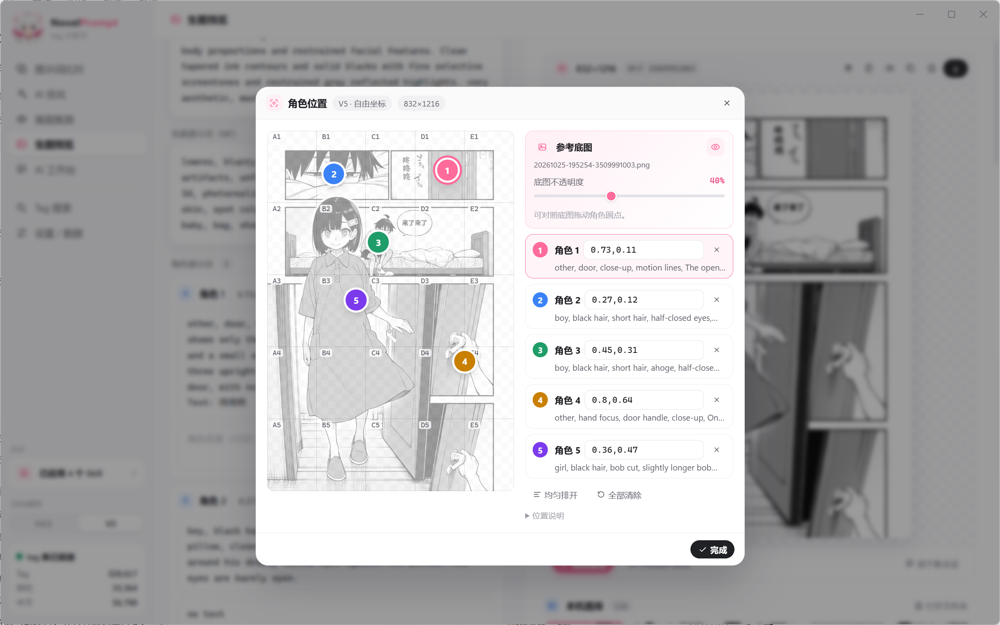
</p>

### 提示词比对

左边输入，右边实时拆成四组。上方可以切换检查主提示词、每个角色、角色负面或全局负面：

- **不存在的 tag** — 红色标出，用编辑距离给出候选，点一下就替换，也可以全部移除
- **别名 / 非标准写法** — 例如 `twin tails` 会提示改成 `twintails`，可以一键全部修正
- **有效 tag** — 中英双语、分类、引用数、实际权重，双击中文可以改成你习惯的译名
- **自然语言 / 文字** — V5 允许的英文句子、`Text:` 块会被单独列出，不会误报

点右边任意一条结果，左边会选中对应的原文。整理格式、复制、清空、跳转 AI 优化在输入框下方，替换、移除、整理都可以 `Ctrl+Z` 撤销。

<p align="center">
  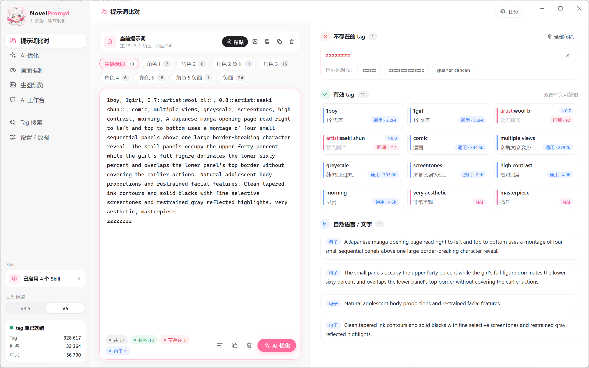
</p>

### AI 优化

只有**一个输入框**，按当前状态自动决定做什么，不需要先选模式：

- **当前提示词为空时** — 把描述转成整套提示词：AI 拆成概念后到本地库里挑真实存在的 tag。共享的画风、构图、背景放主提示词，人物按「区域单元」拆成角色提示词：每个人一个；同一个人在画面里出现多次（比如前后对比、分身）每次各一个；漫画分格里每格的每个人各一个。每个单元排好位置（V4.5 用 A1~E5 网格），互动成对写 `source#` / `target#` 或双方都写 `mutual#`，台词用 `Text:` 写在说话人的角色提示词末尾，容易混淆的特征写进对方的角色负面防串色，最后配一套负面提示词
- **已有提示词时** — 在这个输入框里写「换成夜景」「左边的女孩改成在笑」，就是在它基础上修改；**留空**则表示只做规范化检查。修正拼写和别名、删掉冲突和冗余、按规范顺序重排、补上缺失的关键 tag。正向、角色、负面作为一整套评估：检查主提示词和角色的分工、人数 tag 与角色数是否一致、位置写法、防串色，以及正负面有没有互相抵消（比如黑白漫画风却在负面留着 `screentone`）
- **已有提示词但想推倒重来** — 勾选「按描述重新生成，不保留当前提示词」，这次请求不会带上现有内容，当前提示词会淡化显示

按钮文字会跟着变：能保留当前内容时是「优化提示词」，否则是「生成提示词」。画面推测页的「带着建议去 AI 优化」会把想要的效果、差距和建议写进这个输入框。

AI 不能凭空编造 tag：它会调用本地 tag 库检索和校验，涉及角色、画师时查 Danbooru 共现统计，近义词拿不准时读 wiki 释义；输出前由程序在本地再复查一遍，发现不存在的 tag、角色结构问题（区域单元、互动前缀没配对、台词放错位置或被改写）会打回重改，最多两轮。

AI 按侧栏里启用的 [Skill](#skill自定义-ai-规则) 编排，换成自己的规则就能得到自己习惯的写法。

结果**不会直接覆盖**你的提示词：

- 每段结果下面标出改了哪些 tag（新增绿色、删除红色、改权重橙色）
- 「修改说明」按正向 / 角色 / 负面 / 可选建议分组，每条都带依据标签（见[评判依据](#评判依据)）
- 点「采用」才写入当前提示词，采用前自动存历史，可以撤销；也可以「采用并比对 / 推测画面 / 生图」一步到下一环节

<p align="center">
  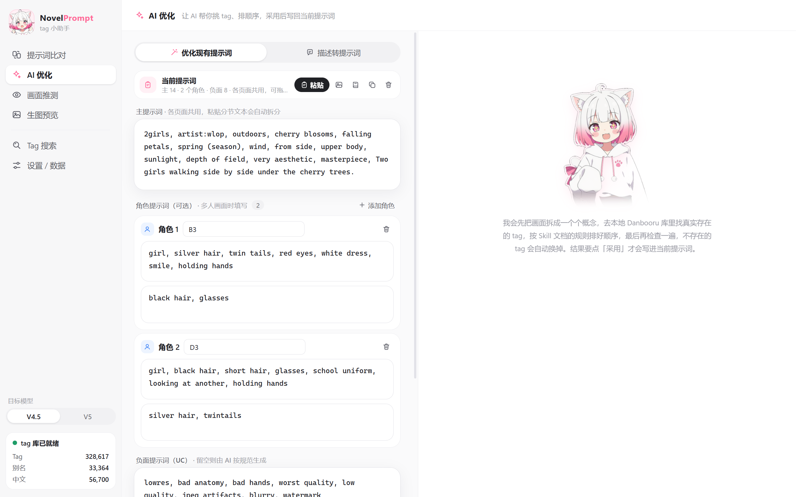
</p>

### 画面推测

让 AI 推测当前提示词实际会画出什么：

- **先查库再推测** — 每个 tag 的分类、引用数、中文、实际权重先由本地 tag 库查好；角色、画师会自动查 Danbooru 统计（角色默认外观、画师倾向）。不存在或样本太少的 tag 会被标成「效果弱」，减少瞎猜
- **考虑隐式参数** — 画幅、Add Quality Tags、UC 预设会自动追加的内容也算进去，与生图页共用同一组参数
- **本地校验** — 不经过 AI 直接查出：不存在、别名、权重过高、正负面重复（含 UC 预设）、包含关系冗余、与角色默认外观冲突
- **结果分项展示** — 画面描述、画风、构图、场景、光影、每个人物，被强调 / 被负面压制的元素，可能和预期不一样的地方；每项标置信度，点结果里的 tag 能在左边定位原文
- **对比期望** — 填上「想要的效果」，会指出差距并给出具体到 tag 的修改建议
- **过期提醒** — 推测之后改了提示词或参数，会提示结果可能已过期

推测规则来自侧栏里启用的 Skill（默认是《内置 · 画面推测》），可以换成或叠加你自己的。

<p align="center">
  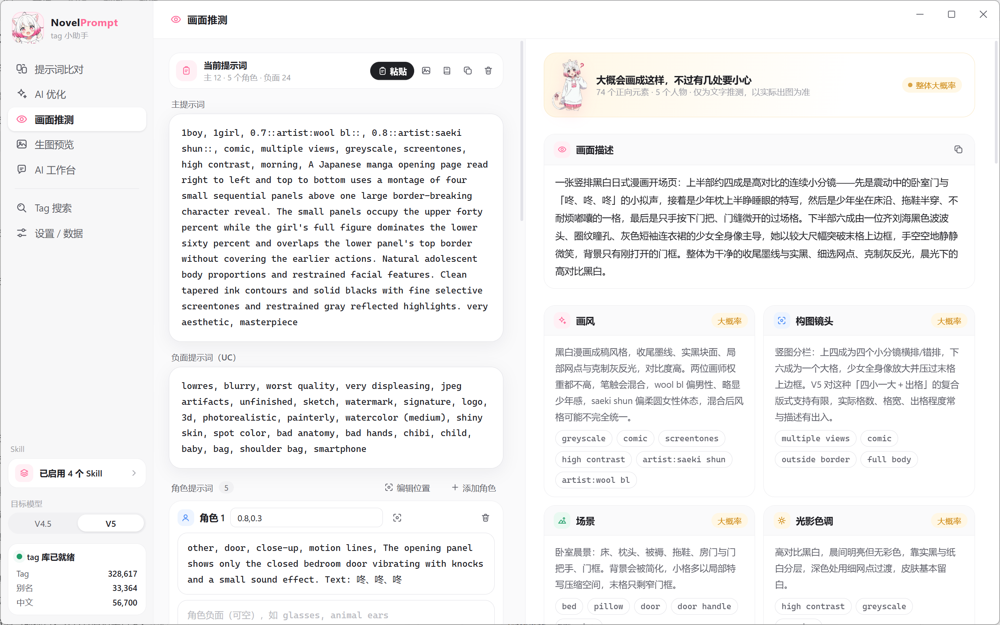
</p>

### 生图预览

普通生图默认是**临时图片**，在软件完全退出后清理。生成按钮旁的「自动留存」随时可开关，设置会记住，变化从下一批生图开始生效；不会补存之前的临时图，也不会删除已留存图片。有后台任务或 Agent 连接时，关窗口不等于退出，临时图会继续保留。程序异常退出后的临时文件会在下次启动清理。

结果区可「留存图片」或「留存最近一批剩余 N 张」。批量按钮只在查看最近一批的临时图时出现，浏览更早的图片不会误操作另一批。图库可筛选全部、临时未留存、已留存和工作台归档。「下载」导出到自己选择的位置，「留存」保存在应用图库中，两者用途不同。旧版图库保持原样，不会作为临时图片清理；被旧工作台会话引用的图片会显示为工作台存档，包括回收站中的会话。

选中缩略图后会常显下载、删除入口；预览区和大图工具栏也可直接点「删除图片」。首次点击后，在 3 秒内再次确认才移入系统回收站。大图中可按 Delete，再按一次确认，长按不会连续删除。删除后自动查看当前筛选下的相邻图片，删完最后一张则关闭大图；切换图片会取消待确认的删除。工作台引用的图片显示置灰的删除按钮，并提示「工作台引用中，无法从图库删除」，继续随项目保留。

临时文件清理遇到文件占用、权限或目录异常时，不阻断启动；界面显示原因与「重试清理」。能清理的文件继续处理，被占用图片的生成记录也会保留。重试只处理上次运行的遗留文件，本次新生成的临时图片继续保留到退出。

「收藏此图配置」独立保存该图实际使用的提示词、角色、模型、参数、当次种子与缩略图，原图仍可以保持临时状态。打开「配置收藏」也可直接「收藏当前配置」，无需先生成图片，生成张数、质量词开关、负面预设等一并保存。选中收藏后点击底部「加载配置」，默认保留完整设置；取消「保留收藏中的种子」才会将种子改为随机。收藏支持名称、标签、备注、搜索与删除。局部重绘配方只复用提示词和设置，不包含底图与遮罩；缺少完整生成记录的旧图片会明确提示，不能将当前界面设置冒充原图配方。

工作台原图已丢失时仍可收藏：优先使用图片配套的生成记录；配套记录也丢失时，使用会话中的不可变生成快照。没有原图则不生成缩略图；当时的模型或种子未记录的旧版本会说明缺失，不能用当前草稿补造历史参数。

填上 NovelAI 的 Persistent API Token 后，直接调用 NovelAI 图像接口出图，验证提示词的真实效果：

- **完整参数** — 画幅、步数、Prompt Guidance、Guidance Rescale、种子、采样器、噪声调度、张数。质量词和 UC 预设由本工具显式拼进提示词，发送的就是最终内容
- **角色位置** — 填 `B3` 这类网格或 `0.3,0.5` 坐标，或用「编辑位置」在画布上拖动，会转换成接口的角色中心点
- **只用免费额度（默认开启）** — 生成前检查 Opus 会员、V5 免费额度、尺寸（总像素 ≤ 1024×1024）和步数（≤ 28），不满足就不提交；每张生成后分别核对订阅和购买的 Anlas，发现扣除立即停止
- **推测 vs 实际** — 用推测过的那套提示词生成的图，下方会显示推测结果，方便对照准不准
- **本机图库** — 预览、全屏（`←` `→` 切换）、下载、复制图片、固定种子重画、读回图里的提示词、送去画面推测
- **局部重绘** — 选中图库图片，点击图片下方「局部重绘」。用画笔或框选标出修改区域，橡皮可擦除选区，支持撤销、清空与放大画布。优先读回原图的主提示词、负面和角色描述，在独立草稿中修改，再调整重绘强度、模型、步数、Guidance 和种子；不会覆盖工作区提示词
- **AI 区域批注（可选）** — 默认显示手动提示词面板。可以先涂多处，再右键其中一处选择「新增批注」：只提取右键位置所在的连通选区，互相接触的多笔属于同一区域，其他未批注选区保留。标记落在右键位置，使用固定双字母短标识（如 KQ），内部用 UUID 绑定数据；删除或新增不会重排其他标识，同一编辑会话中新区域不会复用已删除区域的标识；最多 8 条。浮动卡片可填写修改内容并选择角色，也允许留空。继续涂抹会使用未批注的工作遮罩，不会自动补进已有批注；要补画已有选区，请选择「编辑此区域遮罩」，结束后点击「完成遮罩编辑」。所有遮罩统一使用不透明度滑块的值，新增、完成或切换批注不会改变深浅，重叠选区也不会重复叠加显示透明度。「修改批注」在右侧按创建顺序集中列出，默认收起，展开后可修改文本、角色及角色提示词；不在画布上方增加工具栏。右键可删除批注并保留选区，或删除整个区域。点击「分析批注」仅分析有内容的批注，逐区域查看修改前后和理由，再选择采纳。修改批注或遮罩会使该区域建议失效，修改原始草稿或模型会使全部建议失效；采纳不会直接生成图片
- **逐区域生成** — 可重绘当前区域，或按创建顺序串行生成所有已采纳区域；每个区域使用自己的遮罩与独立提示词草稿，后一区域以前一区域结果为底图。每张另存；失败、额度不足或检测到扣费时停止后续区域，也可主动选择「停止后续区域」。重新执行从原图开始。当前批注和草稿保留在本次弹窗会话中
- **AI 图片与批注分析** — 始终发送原图、带选区标记的局部裁剪、批注及提示词，直接复用设置中的 AI Key、Base URL 和模型，无需选择分析模式或另配看图服务。模型需支持兼容 Chat Completions 的图片输入；不支持时显示接口错误，不会静默退回文字模式。旧版本的独立看图配置不再参与请求
- **图片缩放与移动** — 点开图片大图或进入局部重绘后，滚轮以光标所在位置为中心缩放；按住空格加左键拖动，或直接中键拖动。大图查看也支持直接左键拖动。按钮「适应窗口 / 画布」恢复居中显示；笔刷和橡皮的圆圈按实际像素大小与当前缩放同步变化
- **重绘请求** — 发往 NovelAI 的遮罩为与原图同尺寸的不透明黑白 PNG，白色重绘、黑色保留；1/8 尺寸仅用于内部网格对齐，发送前恢复原尺寸并铺黑底。界面粉色覆盖不写入生成底图。默认重绘强度为 1；降低强度时会更多参考选区内的旧像素。
- **重绘结果对照** — 生成后可切换原图 / 遮罩与重绘结果；「再试当前区域」仍基于原图与当前区域遮罩，「以结果继续修改」则以新结果为底图、清空遮罩。每次结果另存到图库，选区外像素由本地合成保留。V4.5 Full / V5 Full 均可用，并沿用免费额度检查；当前支持宽高为 64 倍数、总像素不超过 4096×1024 的图库 PNG，按原图尺寸处理，不自动裁切放大

<p align="center">
  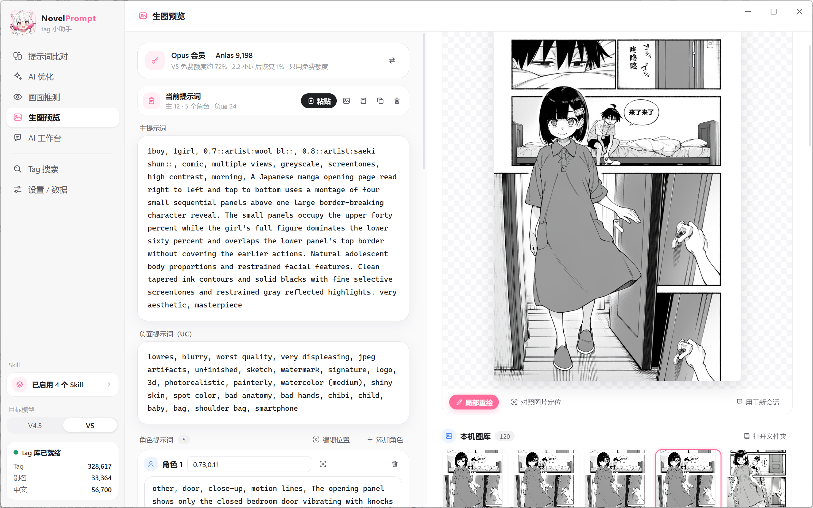
</p>

**局部调整：圈出区域，说明要求，再检查 AI 建议。** 下图展示选区批注与提示词修改前后的对照，采纳方案后仍需单独执行重绘。

<p align="center">
  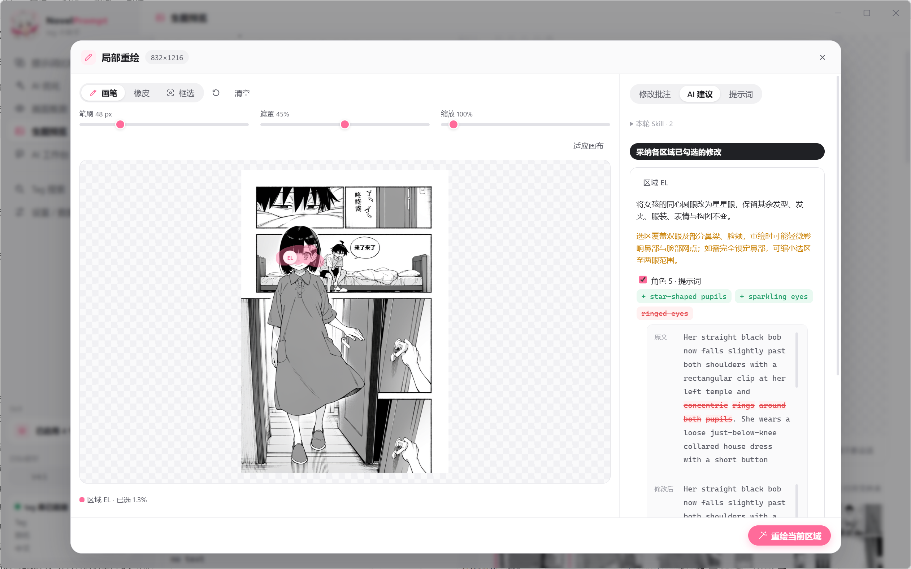
</p>

### AI 工作台

**围绕一张图持续讨论：看当前画面 → 提出修改要求 → 核对方案 → 执行 → 比较结果。** 画布和对话并排，画布、生图配置与修改对比分页展示，待处理的 AI 方案位于对应对话消息内。

<p align="center">
  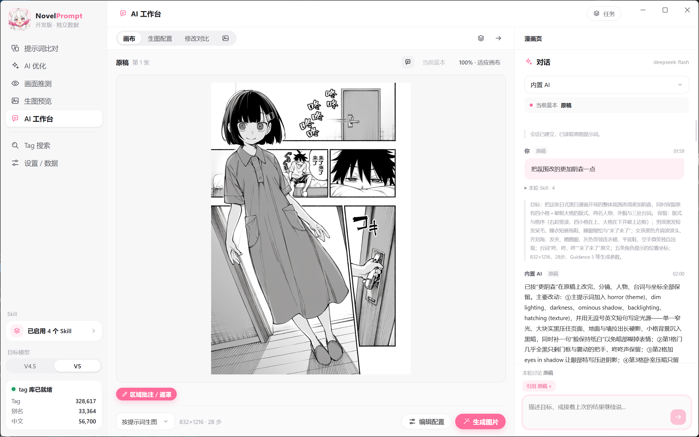
</p>

从左侧「AI 工作台」主动新建创作会话，可以从想法、当前提示词或外部 PNG 开始。图库图片在「生图预览」中选中后点击「用于新会话」，携带缩略图进入新建表单，点击「开始会话」才创建记录。工作台不预设题材，独立保存当前草稿、对话和尝试历史；生图预览继续用于单次尝试，不再叠加会话列表。

- **明确开始与管理** — 打开新建表单不会自动创建会话。创建后可重命名、返回列表继续或删除。删除项目时同步清理所属图片及生成文件，移入系统回收站；其他项目仍引用的文件保留。项目记录移入本机 `data/page-workspaces/removed/`，恢复记录不会自动恢复已清理的图片。
- **通过对话持续调优** — 内置 AI 根据用户明确表达整理目标和保留要求，更新会写入对话记录，可直接通过对话纠正，无需填写约定表。每轮带入当前图片（若有）、草稿、执行方式、区域批注、近期对话和引用的历史图片。最多携带最近 24 条完整消息及 50 条更早的关键摘录，并非无限上下文。
- **启用的 Skill 决定创作方法** — 使用左侧启用且适用当前模型的 Skill，并标明各自作用范围，让 AI 按当前任务采用。内部协议只负责 Skill 使用、状态、工具与返回格式，不预设漫画等题材，也不追加未启用的 Skill。每轮回复可查看本轮使用的 Skill；词库就绪时可按需查询 tag。
- **图片配置与下一版分开** — 版本页内「生图配置」只读图片生成时的完整快照；底部「编辑配置」随时打开下一次生成的提示词和参数，无需先获得 AI 建议。表单复用普通生图页布局。点击「返回查看」保存并回到原查看页面，点击生成先保存再执行；保存失败时保留输入。切换查看版本不会覆盖下一版配置，采用其他图片才明确切换创作起点。底部执行方式、参数摘要、编辑/返回和生成集中在固定一行。生成张数可选 1、2、4，质量词与 UC 预设可以编辑并实际生效；同批图片逐张生成、保存实际配置和种子，中途停止会保留已完成结果。已有遮罩时画幅与底图绑定，移除遮罩后才可调整尺寸。项目标题固定在对话区上方并单行省略；Tab、版本历史和返回项目图标在左侧同一行。
- **看清再采纳** — AI 回复支持 Markdown，方案显示在对应消息内；前台采纳后写入下一版草稿并进入编辑页面，可继续手动微调再生成。支持拒绝与撤销，已处理方案默认折叠，不再有独立 AI 建议页签。目标、草稿、选区、参数或执行方式变化后，旧方案不能覆盖新状态。外部 Agent 可使用 `ui_edit_workspace_config` 的 begin/update/save/cancel 操作同一表单，并从 `get_app_state` 读取配置与禁用原因；不会覆盖用户或其他连接正在编辑的表单。
- **批注与执行分开** — 画区域、写批注用于说明位置，本身不会切换执行方式。「按提示词生成新图」只使用草稿；「局部重绘当前图片」使用当前底图及明确选定的遮罩。AI 可建议执行方式，用户采纳后仍需单独点击执行，重绘前可检查实际遮罩。
- **保留每次尝试** — 「修改对比」展示每轮提示词生图或局部重绘的记录，默认比较当前结果与实际来源版本：并排查看图片、逐词对比提示词与角色位置、查看参数变化和当时的遮罩及批注。记录使用不可变的生成快照，后续编辑不会改写历史；首轮与会话初始草稿及设置比较，缺少旧快照时明确提示无法还原。仅展示实际变化的提示词、角色位置和参数；相同配置不重复列出，完整配置在「生图配置」查看。查看历史不改变当前采用版本，可引用最多两张历史图片讨论，或「从此版继续」生成新的分支。
- **持续保存与旧版迁移** — 名称、输入草稿、批注与编辑状态保存在本机。旧工作区升级为通用会话，旧版区域独立草稿保留为历史条目。外部 PNG 保留本机副本，活动会话引用的图库图片不能直接删除。

工作台图片始终独立归档，从普通生图或外部 PNG 建立会话时会保存自己的副本。相同提示词、模型与配置连续抽图归入同一「方案」的多个候选，种子变化不会拆分方案；重绘底图、遮罩和强度也参与方案区分。改变方案后再改回，会另建方案，旧记录编号和引用保持不变。

首张结果自动设为创作蓝本，之后只预览新候选；点击「设为蓝本」才切换后续编辑和重绘的起点，界面以「当前蓝本」标明。修改对比默认使用实际生成来源，也可选择其他候选作对比，使用生成时的快照。工作台暂不提供收藏联动；普通生图页仍保留原有收藏功能。

输入框上方会显示「本轮讨论」的版本。查看候选或历史版本后提问，内置 AI 和外部 Agent 都会收到该版本的图片信息与配方快照；修改建议仍针对当前采用稿，要在候选图上继续修改，请先采用它。发送后切换画布不会改变已提交的讨论对象，对话记录也会标注讨论版本与修改目标。每轮需求保存当时启用的 Skill 内容；外部需求的讨论图片失效或修改目标发生变化时，旧回复会被拒绝，需要取消后重新发送。导入图片的起始配方只代表会话设置，不代表该图片实际使用的生成参数。

工作台内打开「本版图片」，悬停某张缩略图时，右上角显示垃圾桶。点击后在该缩略图内确认删除，操作始终针对这张图片，不会打开画布或切换蓝本。删除后缩略图从图库移除，仍停留在图库，方便继续清理；版本编号、提示词、生成参数和讨论保留，原版本标记「图片已清理」。清理当前蓝本后切回按提示词生图，不能继续用已清理的图片重绘。其他项目仍在引用的文件保留，否则图片及其生成文件移入系统回收站，图库同步刷新。独立收藏的配方和缩略图不受影响。

项目列表删除项目时同步清理所属图片；以前删除项目留下的图片，可用首页「清理遗留图片」统一移入系统回收站。已有项目使用中的图片及文件不会被遗留清理处理；清理失败会提示，可释放占用后重试。项目记录仍归档留存，但恢复项目记录不会自动恢复已清理文件。图库中的工作台存档会提示前往工作台清理。

手动在文件夹删除图片后，版本仍在，显示缺失状态，保留文字对比与设置复用；看图和重绘不能使用缺失图片。「恢复原图」只接受与记录校验一致的原始 PNG；没有校验记录的旧图片应导入新会话，避免把另一张图冒充历史结果。

导入支持不超过 40 MB、4096×1024 总像素的 PNG。局部重绘要求宽高为 64 的倍数；其他尺寸可进行图片讨论，不自动拉伸。每个会话最多保留 1000 个状态/候选。`npm run pages:smoke` 与 `npm run retention:smoke` 使用隔离配置并拦截所有模型请求；测试数据保存在系统临时目录，可用 `NP_TEST_ARTIFACTS` 指定工作台测试截图目录。

<details>
<summary>开始：从描述、当前提示词或已有图片新建会话</summary>

选择起点、填写本次目标后再开始，也可以回到已有会话继续。

<p align="center">
  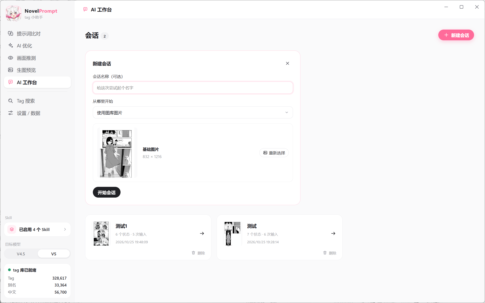
</p>

</details>

<details>
<summary>历史界面示意：核对方案后再决定是否采纳</summary>

建议页保留完整的修改前后内容，右侧对话用于说明理由和继续沟通。

<p align="center">
  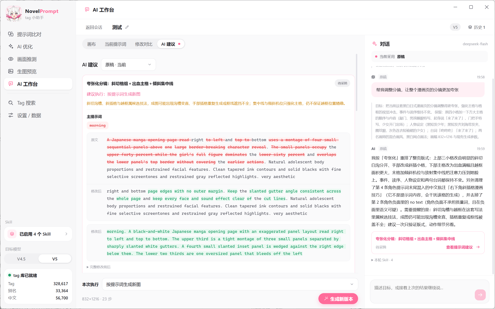
</p>

</details>

<details>
<summary>复盘：并排比较图片与本轮实际使用的提示词</summary>

修改对比连接来源版本与生成结果，既能看画面变化，也能追溯当时的提示词和参数。

<p align="center">
  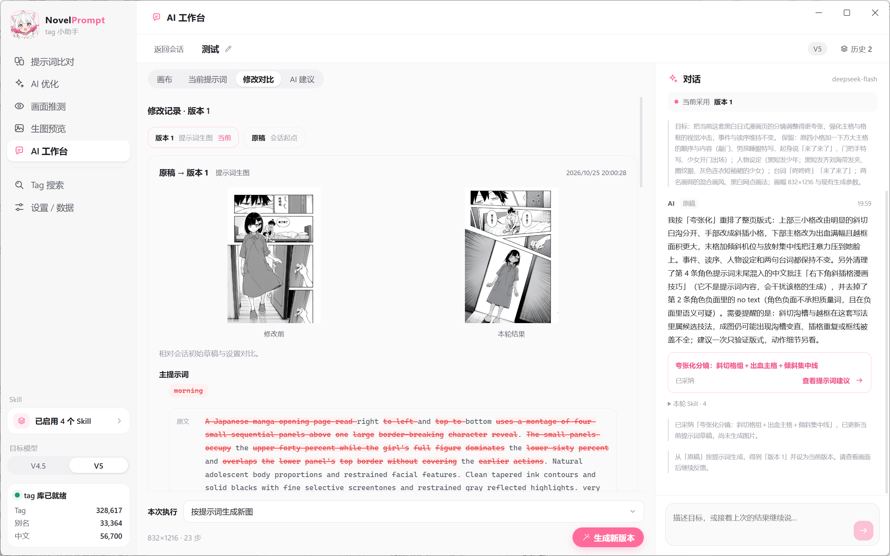
</p>

</details>

### Skill（自定义 AI 规则）

AI 优化 / 描述转提示词、画面推测、局部重绘优化及 AI 工作台的创作规则都写成 Skill（Markdown 文档），完全由你决定用哪几份、按什么顺序：

- **内置三份** — 《内置 · 提示词编排》（AI 优化）、《内置 · 画面推测》和《内置 · 局部重绘优化》（选区批注、最小修改、冲突与保留要求），随软件更新，只读。想改就「复制为我的 Skill」，在副本上改
- **你自己的 Skill** — 导入 `.md` 或新建。每份可以设适用功能（AI 优化 / 画面推测 / 局部重绘 / 全部）和适用模型（通用 / V4.5 / V5），切换目标模型时不适用的会自动跳过。局部重绘对应 frontmatter 中的 `scope: inpaint`
- **启用与优先级** — 点侧栏「目标模型」上方的 Skill 按钮，开关每一份、拖动排序（数字越小优先级越高）。底部会显示每个功能实际生效的链路和字数，太长会提醒。启用设置对所有目标模型通用
- **冲突怎么处理** — 软件内置一份固定的《Skill 使用总则》，放在所有 Skill 前面，告诉 AI 怎么读取启用的 Skill：先按你的「额外要求」，再按优先级从高到低；冲突只按条处理，没冲突的规则都保留。输出格式、`Text:` 和位置写法这类软件依赖的约定优先于所有 Skill。可以只启用自己的一份，完全按你的风格来
- **始终生效的检查** — tag 查询、模型角色数量上限、位置格式和输出结构这类程序能力仍保留；具体编排方法从启用的 Skill 读取。画面推测不再自动附加未启用的编排文档
- **管理** — 导入、新建、编辑、复制、删除放在「设置 / 数据 → Skill 管理」，侧栏只负责启用和排序。用户 Skill 存在 `%APPDATA%\novel-prompt\skills\user\`，可以「打开文件夹」直接用编辑器改

<p align="center">
  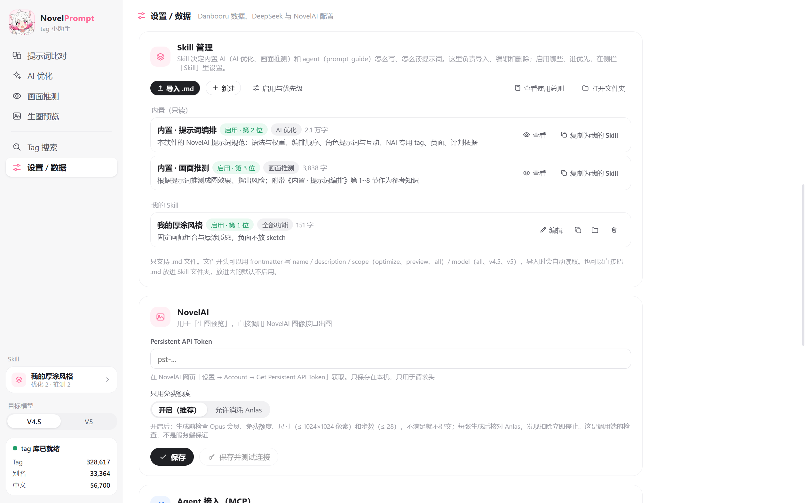
</p>

截图中的自定义 Skill 仅作使用示例；安装包提供上述三份内置 Skill，自己的规则可按需导入。

从旧版本升级时，如果你改过以前的 `nai-prompt.md` / `nai-preview.md`，会自动转成「我的修改版 · …（迁移）」并替代对应的内置 Skill 启用，行为和升级前一致；没改过的直接使用新版内置。

### Tag 搜索

- 中文、英文、**拼音全拼和首字母** 都能搜（输入 `smw` 就能找到「双马尾」）
- 按分类筛选：通用 / 画师 / 作品 / 角色 / 元数据 / NAI 专用
- 结果按匹配度 × 引用数排序，引用数高的 tag 效果通常更稳定
- **单击加到最近编辑的输入框**（主提示词、某个角色或负面，也可以在右上角手动选），画师自动带 `artist:` 前缀；右键复制，双击中文编辑翻译

<p align="center">
  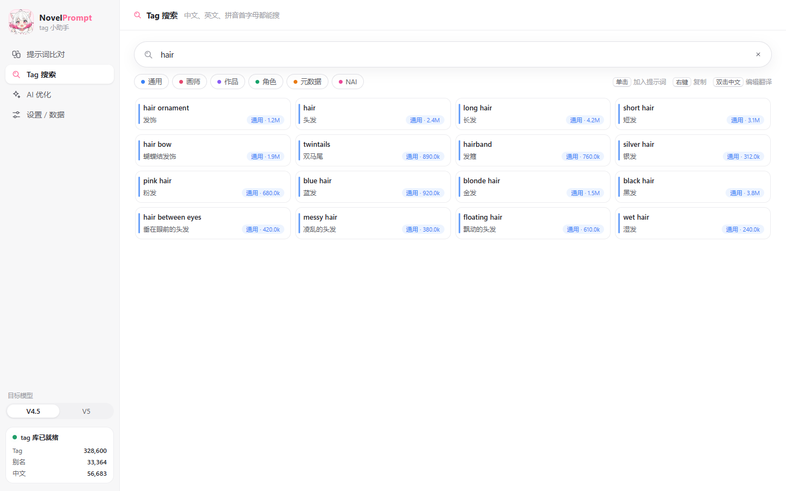
</p>

### 评判依据

NAI 的动漫模型使用 Danbooru 体系的标签，所以 AI 给建议时优先引用 Danbooru 的统计数据作参考，而不是凭感觉。每条修改和建议都会标上依据：

| 标签 | 依据 | 例子 |
|---|---|---|
| 规则 | tag 不存在、别名、版本、语法、正负面重复、人数与角色数、位置写法 | `twin tails` → `twintails` |
| 数据 | 引用数、**包含关系**、**共现统计**、wiki 释义 | `white thighhighs` 已包含 `thighhighs`；初音未来的图里 51% 是 `aqua hair`，写 `red hair` 会互相拉扯 |
| 文档 | 规范里的官方说明或经验做法，依据里注明【官方】/【经验】 | 【经验】漫画风的负面不该有 `screentone` |
| 审美 | AI 的审美判断 | 只作为可选建议，**不会直接改动你的提示词** |

优化结果还会和原提示词对照：原有内容被删掉、而修改说明里没有交代的，会打回让 AI 恢复或说明理由，仍未说明的单独列出来提醒你。

- **包含关系**内置在安装包里，离线可用，用来发现冗余
- **共现统计**（角色默认外观、画师倾向）和 **wiki 释义**联网查询 Danbooru，结果缓存 30 天。没网时自动降级，并在结果里提示哪些判断只凭经验

### 任务中心与应用更新

顶部任务中心显示界面与 Agent 的任务、进度和取消入口。生成任务取消时会保留当前已完成的图片；任务状态不会改变左上角标识。多个 Agent 与窗口共享生成锁，避免并发提交图片任务。

v0.6.0 起的 Windows 安装版在启动后和每 6 小时检查正式新版，后台下载后提示「重启并更新」。用户点击后先等待任务结束、保存关键编辑，再安装并重启；普通退出不安装。便携版和 v0.5.0 及更早版本需手动下载。应用内更新包括内置 Skill，用户 Skill 和会话在独立数据目录保留。参见[自动更新说明](auto-update.md)。

### Agent 接入（MCP）

Codex、Claude Code、Cursor 等支持 MCP 的 Agent 可以直接调用本软件。没有运行中的宿主时，代理启动无窗口服务；已有窗口时共用宿主、状态与任务。前台工具按需打开实际窗口，不需要电脑操作插件。

工作台右侧可选择「内置 AI」或「外部 Agent 接管」。外部模式发送需求后，由 Agent 主动读取本轮图片、选区、历史和冻结的 Skill，自己分析并写回回复/方案；不调用 DeepSeek，不会自动唤醒外部模型。连接断开后保留需求，不自动回退内置 AI。建议、采纳与生图仍是分开的步骤。

前台模式使用 `ui_*` 展示逐步操作；后台模式直接读写共享数据，不展示交互步骤，部分结果仍会同步界面。首次接入读取 `agent_guide`，按需选择 overview/capabilities/workflows/recovery/limits/all；完整操作指南也通过 `novelprompt://guide/agent` 提供。前台操作可穿插后台读取，不混入后台写入。详见[能力选择与工作流](agent-install.md)。

**规则和软件内保持一致**：agent 通过 `prompt_guide` 读到的，就是软件里 AI 优化用的那套——《Skill 使用总则》+ 你在侧栏启用的 Skill（按优先级排好），前面附一段工具使用说明和交付格式。你在软件里换了 Skill 或调了顺序，agent 下一次读取就按新规则执行；agent 也可以通过 Skill 工具帮你新建、修改 Skill。

#### 让 agent 自己装（推荐）

[`docs/agent-install.md`](agent-install.md) 是写给外部 agent 的安装说明：检测本机是否已安装 → 征得你同意后从 Releases 下载并静默安装 → 把 MCP 写进 agent 自己的配置 → 重启验证。

把下面这段话发给你的 agent 即可：

```text
请阅读 https://raw.githubusercontent.com/Morgiana-V3/novel-prompt/main/docs/agent-install.md ，
按说明在我的电脑上安装并接入 NovelPrompt，完成后告诉我需要做什么来生效。
```

#### 已经装好软件时

「设置 / 数据 → Agent 接入」：

- **Agent 自动配置** — 一段带好当前安装路径的话，复制发给 agent，它会自己写进它的 MCP 配置
- **手动配置** — TOML / JSON 配置可以复制，照着填进 agent 的配置文件
- **权限开关与调用记录** — 会花钱的工具默认关闭；返回给 agent 的内容不会包含任何 Token

配置里的路径取自本软件当前的安装位置，换了安装目录后需要重新配置。

#### 工具

| 工具 | 作用 | 默认 |
|---|---|---|
| `prompt_guide` | 返回工具使用说明 + 当前启用的 Skill（可传 `version` 指定 V4.5 / V5） | 可用 |
| `analyze_prompt` | 整套提示词的本地检查：逐 tag 存在性 / 别名 / 引用数 / 实际权重，冲突、冗余、角色默认外观冲突，附角色和画师的统计数据 | 可用 |
| `search_tags` / `validate_tags` | 本地 tag 库搜索与校验 | 可用 |
| `related_tags` / `tag_wiki` | Danbooru 共现统计与释义（联网） | 可用 |
| `nai_subscription` / `list_images` / `read_image_prompt` | 余额、图库、读图片里的提示词 | 可用 |
| `list_skills` / `get_skill` | 列出 Skill 及启用状态、优先级；读取某份 Skill 或使用总则（`core`） | 可用 |
| `create_skill` / `update_skill` / `delete_skill` | 新建（写内容、导入 `.md` 路径或复制已有 Skill）、修改、删除用户 Skill；内置 Skill 只读 | 可用 |
| `set_skill_config` | 设置启用哪些 Skill 和优先级顺序 | 可用 |
| `optimize_prompt` / `preview_prompt` | 内置的 AI 优化 / 画面推测，消耗 DeepSeek 额度 | 需在设置中开启 |
| `generate_image` | NovelAI 生图，**强制只用免费额度**，每次必须传 `confirm: true` | 需在设置中开启 |
| `inpaint_guide` | 重绘工作流 + 当前启用的 `inpaint` Skill，说明遮罩规范和能力边界 | 可用 |
| `prepare_inpaint` | 由 PNG 遮罩或原图像素矩形生成遮罩文件、定位预览及范围统计；不联网 | 可用 |
| `plan_inpaint` | 原图＋选区＋批注，返回逐区域 before / after 建议；不会自动采纳或生图 | 需开启 AI 权限 |
| `inpaint_image` | 对指定区域重绘一张，另存图库，保护选区外像素；必须 `confirm: true`，强制免费检查 | 需开启生图权限 |
| `agent_guide` | 能力地图、前后台选择、工作流、异常恢复与限制 | 可用 |
| `get_app_state` / `get_workspace` / `get_workspace_context` | 当前界面、完整会话与本轮冻结上下文 | 可用 |
| `ui_capture_app` / `read_image` | 当前应用截图、图片或选区预览 | 客户端需支持图片 |
| `ui_*workspace*` | 在真实工作台逐步打开、填写、回复、审核、绘制区域和生成 | 内置 AI / 生图操作分别受权限控制 |
| `set_workspace_agent` / `reply_workspace_request` / `cancel_workspace_request` | 后台外部接管、回复与取消 | 不调用内置 AI |
| `list_tasks` / `cancel_task` | 共享任务与取消 | 可用 |

工具按接入范围按需提供，实际名称和参数以连接后的 `tools/list` 为准；完整工作流见 [MCP 接入说明](agent-install.md)。

重绘调用顺序：`inpaint_guide` → `list_images` / `read_image_prompt` → `prepare_inpaint` 并查看 `preview_path` → 自行修改或 `plan_inpaint` → 确认修改内容后 `inpaint_image`。遮罩支持 `mask_path`、`mask_base64`、`rectangles` 三选一；矩形使用原图像素，不是缩放后屏幕坐标。省略提示词时沿用原图元数据，传空字符串或空角色数组表示明确清空；不重复追加质量词或 UC 预设。批量区域需串行执行并以前一张结果为新底图；返回 `stopped` 时停止。升级后需重启 MCP 进程刷新工具列表。

局部重绘的实测图片、请求参数、AI 原始方案和完整报告单独归档在项目外，不随源码保存；项目中保留功能代码、Skill 经验和可重复运行的回归脚本。AI 建议默认展示 tag 增删和权重变化；英文描述进一步细分句内增删，完整前后文本可展开核对。

手动配置 Codex 的示例（实际路径以设置页显示的为准，默认安装位置是 `%LOCALAPPDATA%\Programs\NovelPrompt`）：

```toml
[mcp_servers.novel-prompt]
command = 'C:\Users\你\AppData\Local\Programs\NovelPrompt\NovelPrompt.exe'
args = ['C:\Users\你\AppData\Local\Programs\NovelPrompt\resources\mcp-proxy.cjs']
env = { ELECTRON_RUN_AS_NODE = '1', NOVELPROMPT_MCP_GROUPS = 'all' }
```

> 为什么要经过 `mcp-proxy.cjs`：Electron 在 Windows 启动时会往标准输出写一个空行，部分 MCP 客户端读到非 JSON 内容会报错。代理以 Node 模式运行同一个 exe，通过带会话认证的本地管道连接共享应用宿主，只向客户端转发协议消息；宿主不存在时自动启动。
>
> 便携版每次运行都解压到临时目录，路径不固定，**不支持 MCP**，请用安装版。

### V4.5 / V5 双版本

侧栏可以切换目标模型，会同时影响：

- 比对时的警告（例如在 V4.5 下用了 V5 专用 tag、或用了 V4.5 不认的引号文字）
- AI 的编排规则（多角色位置写法、自然语言混写比例、质量词、各版本专属 tag），以及启用哪些标了 V4.5 / V5 的 Skill
- 编辑位置的画布（V4.5 网格吸附、V5 自由坐标）
- 推测和生图时自动追加的质量词与 UC 预设、生图使用的模型

## 快速开始

### 用安装包（推荐）

1. 到 [Releases](https://github.com/Morgiana-V3/novel-prompt/releases) 下载 `NovelPrompt-Setup-x.x.x.exe`
2. 安装后直接打开，**内置数据已经就绪，比对和搜索不需要任何配置**
3. 按需在「设置 / 数据」里填：
   - DeepSeek API Key → AI 优化、画面推测
   - NovelAI Persistent API Token → 生图预览
   - 「Agent 接入 → 全部安装」→ 让 Codex / Claude Code 调用（也可以[让 agent 自己装](#让-agent-自己装推荐)）

> 环境要求：Windows 10 / 11（x64）。首次启动约需 1 秒加载索引。

### 从源码运行

```bash
git clone https://github.com/Morgiana-V3/novel-prompt.git
cd novel-prompt
npm install
npm run dev
```

国内网络如果卡在 Electron 下载，先设置镜像：

```powershell
$env:ELECTRON_MIRROR="https://npmmirror.com/mirrors/electron/"
npm install
```

需要 Node 20 或更新版本（推荐 22）。

### 打包

```bash
npm run dist     # 输出 NSIS 安装包和便携版到 release/
```

## 使用指南

### 第一次打开

打开就是「提示词比对」页，左下角显示 `tag 库已就绪` 和当前收录数量。

去「设置 / 数据」页按需配置：

1. **DeepSeek** — 填 API Key（在 [DeepSeek 开放平台](https://platform.deepseek.com/) 申请）。模型默认 `deepseek-flash`，也可以填其他 OpenAI 兼容接口；思考强度默认「低」，调高更准但更慢
2. **NovelAI** — 在 NovelAI 网页「设置 → Account → Get Persistent API Token」获取，填好后点「保存并测试连接」。「只用免费额度」默认开启
3. **Agent 接入** — 见 [Agent 接入（MCP）](#agent-接入mcp)

### 一次完整的流程

1. **写或导入** — 在任意页面的「当前提示词」里粘贴，或把 NovelAI 原图拖进窗口
2. **比对** — 先处理不存在的 tag（点候选替换或全部移除），再「全部修正」别名，最后看看有效 tag 的权重和警告
3. **AI 优化** — 有提示词就把「换成夜景」这类想法写进上方的修改要求（留空则只做规范化整理）；没有提示词时直接描述画面。看改动标注和修改说明，满意就「采用」
4. **画面推测** — 可选填「想要的效果」，看推测结果和风险
5. **生图预览** — 确认免费条件满足后生成，对照「推测 vs 实际」；不满意回到第 3 步继续改，改坏了从历史版本恢复

### 查一个 tag

切到「Tag 搜索」，输入中文、英文或拼音首字母。比如想找「双马尾」，`双马尾`、`twin tails`、`smw` 都能命中。单击结果会加到你最近编辑过的那个输入框。

### 改 AI 的规则

内置 Skill 只读，自定义都通过你自己的 Skill：

1. **从内置改起** — 「设置 / 数据 → Skill 管理」里对《内置 · 提示词编排》点「复制为我的 Skill」，在副本上改；然后在侧栏 Skill 列表里启用副本、关掉内置那份
2. **只补充偏好** — 新建一份只写你的偏好（比如「画风固定用厚涂，负面不要 `sketch`」），排在内置前面，两份一起启用，冲突处按你的
3. **用现成的** — 「导入 .md」导入别人分享的 Skill，文件开头可以带 frontmatter（`name` / `description` / `scope` / `model`），没有的话名称取文件名、默认用于 AI 优化，导入后在编辑框里改。导入和新建的 Skill 默认启用并排在第一位

改完保存，下一次调用立即生效。Skill 正文标【V4.5】/【V5】的段落只在对应目标模型下使用。内置规范里标【官方】的是 NovelAI 官方文档写明的内容，标【经验】的是社区经验或本软件的默认做法，写自己的 Skill 时可以参考。

### 数据更新

Danbooru 每天都在变。想用最新数据：

1. 「设置 / 数据」→ 调「最小引用数」（默认 10，约 33 万条；填 1 会到 50 万条，下载更慢）
2. 点「下载 / 更新 tag 数据」，会拉取 Danbooru 的 tag、别名、包含关系和社区中文翻译；只想更新包含关系可以点「更新包含关系」
3. 社区词库没覆盖的翻译，可以点「开始 AI 翻译」用 DeepSeek 补

更新后的数据存在本机用户目录，不会影响安装包里的内置数据。

## 支持的语法

| 写法 | 说明 |
|---|---|
| `tag1, tag2` | 逗号或换行分隔 |
| `{tag}` / `{{tag}}` | 加权 ×1.05（可叠加） |
| `[tag]` | 减权 ÷1.05 |
| `1.3::tag, tag2::` | 数值权重，可包住多个 tag |
| `0.6::tag::` | 0~1 之间为降权 |
| `-1::tag::` | 负权重，主动从画面里去掉某概念（V4.5 起） |
| `artist:名字` | 画师 tag，会校验是否真的是画师分类 |
| `year 2024` | 年份 tag |
| `\|` | 分段，常用于多角色提示词 |
| `source#hug` / `target#hug` / `mutual#...` | 角色间的互动动作，写在角色提示词里，`source#` 和 `target#` 成对出现 |
| `Text: ...` | 画面文字块，放在所在提示词末尾；台词写在说话人的角色提示词里 |
| `"文字"` | V5 引号文字，会自动识别 |
| `long hair` / `long_hair` | 下划线和空格等价 |
| `hatsune miku \(append\)` | 括号是名字的一部分，会正确还原 |

## 数据说明

| 层 | 位置 | 内容 | 读写 |
|---|---|---|---|
| **内置数据** | 安装包 `resources/default-data/`（gzip） | tag、别名、包含关系、社区翻译、AI 翻译、拼音索引 | 只读 |
| **用户数据** | `%APPDATA%\novel-prompt\data\` | 你自己下载的 tag / 别名 / 包含关系、新增的 AI 翻译、手动改的翻译、Danbooru 统计缓存（`knowledge-cache.json`）、MCP 调用记录、设置（含 API Key 和 Token） | 可写 |
| **旧版图库** | `%APPDATA%\novel-prompt\images\` | 保留已有 PNG，不自动迁移或清理 | 可写 |
| **普通生图** | `%APPDATA%\novel-prompt\image-library\temporary\`、`saved\` | 临时或已留存 PNG，以及实际生成设置 | 可写 |
| **工作台图片** | `%APPDATA%\novel-prompt\image-library\workspaces\<会话 ID>\` | 独立归档，随会话保留 | 可写 |
| **配方收藏** | `%APPDATA%\novel-prompt\data\recipes\` | 设置快照、名称、标签、备注及独立缩略图 | 可写 |
| **用户 Skill** | `%APPDATA%\novel-prompt\skills\user\` | 你导入、新建、复制的 Skill（`.md`）；启用与优先级存在设置里 | 可写 |
| **当前提示词** | 应用本地存储 | 当前提示词、共用参数、历史版本 | 可写 |

以上为安装版默认目录。从源码启动（包括 `npm run dev`、`npm run preview`、直接运行 Electron 和仓库 MCP 代理）默认使用 `%APPDATA%\novel-prompt-dev`，会话、图库、设置、Skill 与浏览器存储都与安装版分开。不会自动复制或同步安装版数据。需要沿用旧内容时，先退出相关程序并备份，再单次复制到开发目录；不要用目录链接共享数据。设置页的「Agent 接入」显示当前环境、数据目录和程序目录。

`NOVELPROMPT_USER_DATA` 可指定独立测试目录；开发版拒绝将它指向安装版默认目录及其父子目录（包括链接到这些目录的路径）。开发 MCP 配置名为 `novel-prompt-dev`，安装版为 `novel-prompt`；请从对应环境的设置页复制配置。Agent 可通过 `get_app_state.runtime` 核对连接环境。

- tag / 别名 / 社区翻译：两层里**抓取时间更新的**那份生效；包含关系用户层有就用用户层
- 翻译：按条目合并，优先级 **手动编辑 > AI 翻译 > 社区翻译**，用户层优先
- 升级或重装不会覆盖你的用户数据

**隐私**：DeepSeek API Key 和 NovelAI Token 只存在本机 `settings.json` 里，分别只发送给 DeepSeek 和 NovelAI 官方接口；错误信息和返回给 agent 的内容会屏蔽 Token。导出脚本有白名单，`settings.json` 永远不会被打进安装包。

## 常见问题

**断网能用吗？**
比对和搜索完全离线。AI 优化、画面推测、Danbooru 统计、生图需要联网；统计查不到时自动降级，会在结果里说明。

**要花钱吗？**
比对、搜索、MCP 的检查类工具不花钱。AI 优化、画面推测用你自己的 DeepSeek API Key，按 token 计费。生图默认只用 NovelAI Opus 会员的免费额度，不满足免费条件就不提交；关掉「只用免费额度」后才可能消耗 Anlas。

**「只用免费额度」能保证不扣费吗？**
不能绝对保证。是否扣费由 NovelAI 服务端决定，本工具做的是生成前检查条件、生成后核对两类 Anlas 余额，发现扣除立即停止。

**内置数据会过期吗？**
会。Danbooru 一直在新增 tag，内置数据是发版时的快照。想要最新的就点「下载 / 更新」，之后每次启动都用你更新过的数据。

**AI 挑出来的 tag 还是不对怎么办？**
看修改说明里每条的依据标签，「审美」类的只是建议。规则不合你的习惯就写一份自己的 Skill（见[改 AI 的规则](#改-ai-的规则)），排到内置前面或直接替代它，保存后下一次调用立即生效。

**升级后我以前改的 `nai-prompt.md` 还在吗？**
在。改过的旧文件会自动转成「我的修改版 · …（迁移）」Skill 并启用，替代对应的内置 Skill，在「设置 / 数据 → Skill 管理」里能看到。

**agent 里看不到 novel-prompt 的工具？**
确认「Agent 接入」里对应的项都是「已安装」，然后完全重启 agent。换过安装目录的话会显示「需更新」，重新点一次安装。便携版不支持 MCP。

**能用在 SD / WebUI 上吗？**
tag 部分可以，数据来自 Danbooru，和 SD 通用的那套一致，只是权重语法是 NovelAI 的。

**打包报 EPERM？**
如果输出目录在桌面这类受保护位置，electron-builder 解压 Electron 后改名会被系统拒绝。换个输出目录即可：

```bash
npm run dist -- "--config.directories.output=D:\build\novel-prompt"
```

## 开发者

### 技术栈

Electron 44 · Vue 3 · TypeScript · Vite（electron-vite）· 内存索引搜索 · DeepSeek Function Calling · MCP（stdio，无第三方依赖）

没有用数据库：33 万条 tag 读进内存后用线性扫描 + 打分排序，几十毫秒出结果，省掉原生模块编译的麻烦。

### 结构

```
src/main/tagdb      数据抓取（fetcher）、两层数据读取（layers）、内存索引与包含关系（store）、Danbooru 共现与 wiki（knowledge）
src/main/prompt     提示词解析器
src/main/app        启动、窗口、生命周期与应用协议
src/main/modules    工作台、生成、图片、提示词、标签、规则、设置、任务与更新用例
src/main/providers  NovelAI / 聊天服务的 HTTP、请求与响应协议
src/main/adapters   IPC / MCP / 桌面窗口适配
src/preload/api     按领域暴露受限跨进程 API
src/shared          跨进程契约、领域模型与平台无关纯规则
src/renderer/src    app 装配、features 业务组件/状态、shared 通用 UI 与样式
src/runtime         独立 Node MCP 代理与运行目录解析
skills/             内置规则
scripts/            开发、构建、验收安装包、数据与资源处理命令
tests/              unit / integration / e2e / support；运行产物在项目外
docs/               使用、Agent 接入、架构、验证与代码规范
default-data/       随安装包分发的内置数据
```

### 常用脚本

```bash
npm run dev          # 开发模式（主进程改动自动重启）
npm run build        # 只构建
npm run typecheck    # 类型检查
npm run mcp:smoke    # 使用本机配置验证 MCP 查询和拒绝未确认的生图；不实际生图
npm run inpaint:smoke # 验证遮罩、批注、AI 采纳、看图请求、串行重绘、Skill 范围与额度检查（模拟服务端，不消耗额度）
npm run inpaint:mcp-smoke # 独立配置下验证 MCP 重绘工具、权限、参数和像素保护（不联网）
npm run desktop:smoke # 隔离配置验证前台 MCP、外部接管、截图和冲突保护
npm run mcp:host-smoke # 真实宿主冷启动、指南资源、共享连接和恢复
npm run startup:smoke # 真实主进程的回收站接口、恢复流程及开发启动冲突保护
npm run isolation:smoke # 发行程序与开发程序并行验证数据及 MCP 隔离；只使用临时数据
npm run tasks:smoke  # 任务中心与取消
npm run prompt:smoke # 提示词导入与编辑回归
npm run update:smoke # 更新下载、校验和重试；不执行安装器
npm run pages:smoke   # 隔离配置中验证会话、AI 建议、版本对比与 Markdown（不调用在线模型）
npm run screenshots  # 生成演示截图（release/screenshots/），不覆盖 README 精选图片
npm run dist         # 打包安装包 + 便携版
npm run data:export  # 把本机数据导出为内置数据 default-data/
```

开发启动前会检查本项目是否仍有应用或 MCP 宿主运行。若提示已有宿主，请先保存工作、断开 MCP 连接并退出应用，再运行 `npm run dev`；仅关闭窗口时，MCP 连接可能让后台继续驻留。检查失败时不会覆盖构建文件，避免新界面调用旧后台接口。开发实例启动后再连接 MCP，即可共用该实例。

### 更新内置数据（发版前）

```bash
npm run data:export   # 从开发版数据目录导出到 default-data/；可用 NP_DATA_DIR 显式指定来源
npm run dist
```

导出脚本只认白名单文件（tags / aliases / implications / zh-community / zh-ai / zh-user / pinyin-cache），`settings.json` 不会被导出。

### 截图

README 中的图片为人工挑选的实际操作截图，保存在 `screenshots/`，按功能配图；工作台的补充视图放在可展开的详情中，点击图片可查看原图。

`npm run screenshots` 会用示例提示词、示例 Skill 和项目内置素材自动打开各页面截图，包括角色位置、局部重绘、Skill 管理，以及 AI 工作台的画布、建议和修改对比，输出到 `release/screenshots/`，不会覆盖 README 精选图片。运行时使用临时用户目录：不读取你的 Token、会话和 Skill，不改动你的当前提示词和历史。工作台对话及版本是离线演示数据，不调用在线模型。

`npm run screenshots:ai` 会额外读取你设置里的 DeepSeek Key，真实跑一次 AI 优化和画面推测再截图（消耗少量额度），这样这两页截到的是带结果的画面。

### 吉祥物

立绘是用 NovelAI 生成的，同一个 seed 保证各个表情是同一个角色（每个页面的空状态、进行中、出错、完成各用一张，尽量不重复）。需要重新生成时：

```bash
$env:NAI_KEY="pst-..."       # 你自己的 NovelAI Token，不要提交；不设置时自动读取应用设置里保存的 Token
$env:NAI_SEED="777"
$env:NAI_STEPS="40"          # 可选，超过 28 步会消耗 Anlas，线条更细致
python scripts/gen-mascot.py [名称...]     # 生成到 assets-src/mascot/，不带名称则全部重新生成
python scripts/process-mascot.py [名称...] # 抠底、裁边、输出到 src/renderer/src/assets/mascot/
```

依赖 Python 3 和 Pillow。`process-mascot.py` 会顺带生成 `build/icon.ico`（应用图标）。

## 本轮图片留存改造：改动对照与验收

对照基线：`00db1e8`（改造前的仓库 HEAD）。这是图片留存、工作台候选和配方收藏的完整改动范围，不含之前已经提交的 AI 优化界面调整。

| 项目 | 改造前 | 改造后 |
|---|---|---|
| 普通生图 | 每张 PNG 长期写入同一图库 | 默认临时缓存，完全退出时清理；异常退出的遗留缓存下次启动清理 |
| 自动留存 | 没有可切换的留存策略 | 生成按钮旁有开关，记住设置；每批开始时固定策略，中途切换影响下一批 |
| 手动留存 | 主要通过导出文件保存到其他位置 | 可留存单张或最近一批剩余临时图，显示数量；导出仍独立可用 |
| 图库分类 | 统一图库 | 全部、临时未留存、已留存、工作台归档四种筛选；图片显示状态，旧会话引用图也正确归类 |
| 工作台图片 | 与普通图片共用图库，部分来源共用文件 | 每个新会话拥有独立副本及归档目录，普通图清理或外部文件移动不影响新会话 |
| 重复抽图 | 每次生成增加一个平级版本 | 版本列表每个配置版本仅显示一项；点击「查看本版本的 N 张生成图」挑选结果，选图后收起列表并预览，明确采用后才更改底图；种子不同仍为同方案；变更提示词/模型/配置或重绘依赖后新建方案 |
| 采用结果 | 每次生成自动切换当前版本 | 首张自动采用，后续只预览候选；用户明确采用才切换继续创作的底图 |
| 修改对比 | 已有生成快照，主要对比生成来源 | 保留原有快照与来源关系，并可选择其他候选比较；补记当时模型与实际重绘噪声设置 |
| 图片缺失 | 部分讨论、编辑或切换操作直接报错 | 版本记录保留，显示缺图状态，支持文字讨论、设置复用和文字对比；重绘仍需真实底图 |
| 恢复原图 | 没有界面入口 | 从缺图状态选择原始 PNG，按内容校验，拒绝用另一张图替换历史 |
| 会话删除 | 后台保留删除记录，图片继续占用图库 | 删除项目同步清理图片；记录仍归档；首页支持清理已删项目的遗留图片，共用文件保留 |
| 配方收藏 | 无 | 收藏实际提示词、角色、模型、参数、种子与独立缩略图；搜索、名称、标签、备注、删除、加载预览 |
| 配方复用 | 主要靠读回 PNG 提示词和手动设置 | 普通生图及工作台共用收藏；随机种子复用或固定当次种子加载；工作台加载会清除旧选区 |
| 缺图后收藏 | 无 | 从工作台生成快照建立无缩略图收藏，缺失历史字段会明确提示 |
| 清理异常 | 无临时图库清理流程 | 按文件容错、全局提示、可重试，重试不会删除本次新图 |
| Agent 协作 | 生成结果主要围绕当前版本返回 | 明确返回新候选与已采用版本，提示临时/留存/缺图状态，返回实际存储路径 |

按下面顺序验收即可，建议统一使用新建的「留存功能验收」会话和测试图片。

- [ ] **A01 临时图**：关闭自动留存，生成图片，确认显示「临时」及留存入口。
- [ ] **A02 开关时机**：生成一批多张图片，过程中切换开关；本批状态一致，下一批按新开关执行。再次关闭开关不会删除已留存图片。
- [ ] **A03 单张与整批**：留存一张后数量减少；留存最近一批的剩余图后本批全部已留存。选中较早的临时图时不显示最近一批的批量按钮。
- [ ] **A04 退出与重启**：完全退出软件再启动，临时图消失，已留存图仍在，开关设置仍在。有后台任务或 Agent 连接时关闭窗口，宿主仍在运行，临时图继续保留。
- [ ] **A05 图库分类**：检查四种筛选；已有工作台引用的旧图归入工作台存档，普通旧图仍是已留存，旧文件位置不变。
- [ ] **A06 独立归档**：用临时图新建会话，退出重启后原临时图清理，工作台副本仍可打开、讨论和重绘。
- [ ] **A07 候选分组**：同配置连续生成两三次，候选归入同一方案；只改种子仍不拆分。改提示词后生成新方案，再改回旧提示词也建立新的方案。
- [ ] **A08 明确采用**：首张自动采用，后续生成只改变预览；对话旁标明的当前采用图保持不变。点击「设为蓝本」才切换。
- [ ] **A09 对比与历史**：对比实际生成来源及任意候选；修改当前草稿后，历史图的生成快照不变，旧候选的来源关系不变。
- [ ] **A10 收藏与复用**：无需生图即可收藏当前配置；也可收藏图片的实际配置。修改名称、标签、备注并搜索；加载默认保留种子，核对模型、角色、主负面词、生成张数与参数。取消保留种子后应只改变种子。工作台也能加载同一配置。
- [ ] **A11 收藏独立于图片**：收藏临时图后完全退出，原图消失，但配方和收藏缩略图仍在。
- [ ] **A12 缺图与恢复**：先导出验收用工作台图片的原始 PNG，再从文件夹删除工作台那一份；重新进入会话，版本仍在，文字可用，图片操作受限。仍能从生成记录收藏配方；恢复时错误图片被拒绝，原始 PNG 可恢复。
- [ ] **A13 工作台清理**：单张清理保留版本快照，图库不再显示已移走的图片；删除项目同步清理图片及生成文件；首页可清理旧项目遗留文件，其他项目共用的图片保留。恢复归档记录不会自动恢复已清理图片。
- [ ] **A14 清理失败**：此项由隔离测试验证真实文件占用；启动仍可用且显示重试入口，释放占用后可重试。日常无需手动修改目录权限来验收。
- [ ] **A15 Agent**：调用生成后检查新图与候选编号；新结果不冒充已采用图，返回路径可以读取，缺图时不会被当作已看到的画面。

当前边界：临时图使用磁盘缓存而非全部占用内存；没有完整历史参数的旧图不能伪造精确配方；重绘收藏只包含提示词和设置，不打包底图与遮罩；回收站永久清理、磁盘统计、收藏导入导出与去重属于后续增强。

开发验证包括 `typecheck`、构建、`retention:smoke`、`pages:smoke`、`update:smoke` 和 Agent/重绘回归。安装验收脚本使用独立的 `com.holyxie.novelprompt.acceptance` 身份、专用目录和临时配置，禁用快捷方式及安装后自动运行，不能传入正式安装包：

```powershell
# 基线源码应事先从本轮改造前的 Git 提交导出到该目录，并提供依赖。
$acceptance = Join-Path $env:TEMP "novel-prompt-acceptance"
node scripts/build-acceptance-packages.mjs "$acceptance/baseline-source"
node tests/e2e/installed-retention-smoke.mjs "$acceptance/baseline-local/NovelPrompt-Acceptance-baseline.exe" "$acceptance/current/NovelPrompt-Acceptance-current.exe"
```

安装验收使用测试版本 `0.6.0 → 0.6.1-acceptance.1`，检查真实覆盖安装、旧数据兼容、文件占用、正常退出重启、异常退出恢复，测试结束卸载独立验收程序。仓库的正式版本号不因此改变，也不发布更新。

本轮验证结果：类型检查、构建、留存服务测试、工作台界面测试、更新下载与校验测试、桌面 Agent 协作和 MCP 重绘测试均通过。真实 NSIS 覆盖升级验证也已通过：旧设置、图片、Skill 与会话保留；持有 Windows 文件句柄阻止删除时应用仍能启动，释放后重试成功；正常退出重启与强制结束后的恢复符合留存规则。模型请求均使用测试替身，不消耗用户生图额度。以上自动化验证不替代 A01–A15 的个人体验验收。

## 致谢

- tag 数据、包含关系、共现统计与 wiki 来自 [Danbooru](https://danbooru.donmai.us/)，版权归 Danbooru 及各位贡献者
- 社区中文翻译来自 [byzod/a1111-sd-webui-tagcomplete-CN](https://github.com/byzod/a1111-sd-webui-tagcomplete-CN)
- 界面风格参考 OpenAI Codex 的浅色布局

生图功能调用的是用户自己的 NovelAI 账户，本项目不提供、不托管任何图像生成服务。

## 许可证

[MIT](../LICENSE)


### 查看版本与指定对比

左侧版本是画布、生图配置、修改对比的共同入口。每个版本可能包含多张候选，点击导航栏的图片图标打开“本版图片”，通过缩略图选择查看对象；切换面板保持这一张。查看历史稿不会改变已采用稿，历史稿的提示词只读；点“设为蓝本”后才切换下一版草稿的创作起点。底部「编辑配置」始终编辑当前蓝本的下一版草稿，独立于正在查看的历史图。

“修改对比”的对比对象默认使用实际生成来源，也能指定其他版本的某张候选。它只改变参照图及差异，右侧始终是正在查看的图片。生成记录保留当时的提示词和参数，与后来修改的草稿分开；原稿的初始设置不等于导入图片实际使用的生成参数。

后台 MCP 补充：`submit_workspace_request` 保存外部需求并冻结上下文，`add_workspace_region` 添加已采用图的矩形批注，`compare_workspace_versions` 只读比较指定候选，`list_workspace_requests` 查询待处理需求。写入使用最新 revision，外部接管模式校验所属连接；用户未发送的输入不会被后台提交覆盖。外部模型是否自动醒来仍由客户端决定，应用不保证自动唤醒。


### 创作项目与布局

AI 工作台将一次持续修图称为“创作项目”，其中保留图片、版本、生图配置与讨论。原有记录沿用，不需要迁移；MCP 的 workspace / version 等接口名称不变。新建项目使用弹窗；删除在垃圾桶图标旁二次确认，支持连续操作，并同步清理图片。首页提供「清理遗留图片」，不展示归档记录列表；已有底层项目记录仍保留。

画布、生图配置、修改对比与项目标题位于同一导航栏。“生图配置”提供当前版本的提示词、模型、尺寸、步数、采样器、噪声调度、引导参数、种子和重绘强度；历史配置只读。工作台暂时移除收藏联动、加载收藏与画布下方的 JSON 展示，已有收藏仍保留在原功能中。

外部 Agent 执行前台操作或后台写入任务时，固定顶栏显示“外部 Agent 正在操作”及停止入口；新建弹窗中也可停止。完成提示短暂显示后消退，失败详情可展开查看，都不增加布局行。“已连接”仅表示连接存在，不能证明模型正在思考；客户端中的推理过程不由应用监测。

候选图选择使用“本版图片”缩略图面板；点选只改变查看对象，采用仍需点击固定工具栏中的“设为蓝本”。查看其他候选时执行区仍基于当前蓝本的下一版草稿，不再显示额外状态横条或隐藏执行区；画布空间保持稳定。项目卡片标题单行省略，删除图标与时间同排。


## 导入与管理 Skill 文件夹

在「设置 / 数据 → Skill 管理」中，点击「导入 Skill」，选择「Markdown 文件」或「Skill 文件夹」。Windows 的系统选择窗口分别处理文件和文件夹，软件将它们合并在同一个导入入口中。文件夹根目录必须包含非空 `SKILL.md`；所选文件夹作为一份 Skill 管理，参考资料不单独启用或排序。目录预览确认导入后返回列表，需要修改时再点「编辑」。

目录导入前会预览入口、关联文件和跳过项目。支持 Markdown 与 PNG/JPEG/WebP/GIF，最多 100 个参考文件、总计 20 MB；隐藏文件、依赖和脚本不会导入，不执行脚本。目录链接和符号链接不支持。导入会保存独立副本，同名导入不覆盖原内容。目录入口未声明 scope 时默认适用于全部功能，单文件仍保留原有默认范围。

「查看」和导入预览默认显示排版后的 Markdown，可切换只读源码。左侧文件列表统一显示入口 SKILL.md、参考资料和图片；正文中的包内相对链接可直接打开文件或跳转到标题，包内图片可以直接显示。

退出编辑时，主题确认弹窗提供「继续编辑」「保存并关闭」「放弃修改」。按 Esc 只关闭确认弹窗并回到草稿；失效引用的保存确认也沿用软件主题。侧栏启用浮层的箭头指向 Skill 入口，并随窗口尺寸调整。

「编辑」使用 CodeMirror 6，支持语法高亮、查找、撤销，以及「编辑 / 预览 / 分栏」切换。预览实时反映未保存的内容，切换文件保留各自草稿和撤销记录；Ctrl+S 保存整份 Skill，关闭时有未保存修改会确认。可以新增、重命名或删除参考资料，重命名和删除后需同步修改引用；常见 Markdown 相对链接的失效情况会提示。取消并确认关闭会放弃整包编辑。单文件添加参考资料后自动成为目录包。复制会包含所有资料；导出会在所选位置新建独立目录，已有同名目录不会被覆盖。预览不执行原生 HTML，也不自动加载外部图片。

入口应包含核心约束、执行流程以及资料读取条件，例如「涉及角色身份时读取 [角色规则](references/角色.md)」。内置 AI 可以调用参考资料读取工具，外部 Agent 在工作台通过 `skills_ids` 读取目录中的资源标识。参考正文不默认拼入首次模型输入；讨论提交时冻结参考资料，之后修改或删除 Skill 不改变本轮资料。`skills_task:all` 显式读取全部 Markdown；图片目前仅用于管理和预览，不发送给 AI。

目录包不等于通用插件运行环境。依赖脚本、外部应用或未支持文件格式的 Skill 需要调整后使用。单文件导入不自动收集其所在文件夹中的引用；需要关联资料时请导入整个 Skill 文件夹。

内置规则使用目录管理，但不强求每条规则都拆成参考文件：画面推测常用规则一次加载；局部重绘只有示例按需读取；提示词编排和漫画的大篇专项资料由 AI 根据任务补读。原启用状态和优先级保留，已有用户副本不会自动替换。可在「查看」中检查入口的场景表和各参考文件。[规则组织与加载方式](skill-context.md)


## 随附场景模板

「设置 / 数据 → Skill 管理」现在分为内置规则、随附场景模板、我的 Skill。场景模板随安装包附送，独立于内置通用规则，不出现在启用与优先级列表，也不默认进入模型上下文。

第一份模板是「黑白日式漫画」（nai-manga-prompt-design）：短入口配合 7 份主题资料：输入组织与评估、动作与连续性、格框、镜头、黑白画法与线效、文字与对白、完整实例。选用索引与对应正文放在同一份资料中。原稿的个人画风与参数偏好改为可替换示例。

点击「查看模板」可阅读渲染后的入口和黑白漫画场景资料；点击「复制并定制」会创建包含全部参考资料的用户副本，并打开编辑器。副本默认不启用，修改保存后由你在侧栏启用。模板正文只读，软件更新不会覆盖你的副本。不需要的模板可以点击「删除」并再次确认；删除后从随附目录移除，重启和升级不会重新出现，已复制到「我的 Skill」的内容不受影响。

如果之前导入过旧的漫画 Skill，原来的内容和启用状态会保留。切换到新副本时，请关闭旧版，避免重复加载。可以导出定制后的目录包给其他用户；无需手工修改安装目录。

外部 Agent 可用 `list_skill_templates` 发现模板、`get_skill` 查看入口和指定参考，再按用户要求使用 `create_skill(duplicate_from=...)` 创建个人副本。浏览模板不意味着启用。

Skill 的同级规则使用主题标题和无序列表，引用时用名称与主题，不把章节序号当执行顺序。只有明确规定顺序的提示词排列保留有序列表；型号、数量、优先级、坐标和示例格位数字保留其实际含义。提示词编排的角色与文字规则、负面与模型预设分别归并，参考文件由 7 份调整为 5 份。
